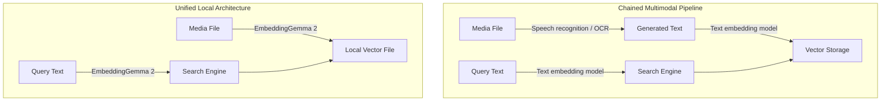
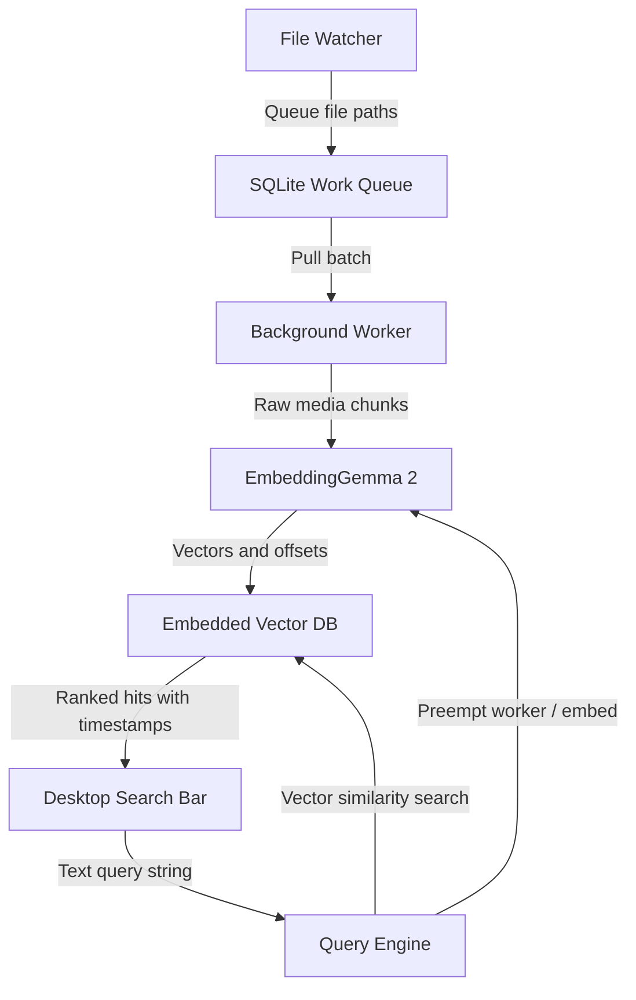

Sending gigabytes of personal video, photos, and voice memos to a cloud vector database introduces privacy risks, ongoing infrastructure costs, and unnecessary bandwidth saturation. For desktop search, cloud vector stores often solve the wrong problem. Running an on-device unified model like Google DeepMind's EmbeddingGemma 2 locally over a user's files allows direct cross-modal retrieval, mapping text, images, audio, and video into a single shared vector space.

Because the model projects all supported media types into the same vector space, a text query can locate matching items across any format without separate transcription, tagging, or optical character recognition passes.

## The Breakdown of Pipelined Multimodal Ingestion

Traditional multimodal search architectures rely on chained pipelines. An audio file passes through a speech recognition model like Whisper to generate a text transcript. A photo or video keyframe goes to an optical character recognition model to pull embedded text, or to a vision-language model to generate synthetic image captions. Finally, those generated text strings pass into a text embedding model to produce vectors for search.

This pipeline approach introduces cascading failure modes:

Transcripts discard non-verbal acoustic signals like room tone, background audio, music, and mechanical noises. If an audio recording has no spoken dialogue, a speech-to-text pipeline generates an empty string or hallucinated silence tokens.

Synthetic captioning models discard fine-grained visual details they do not consider prominent. If an automated captioner summarizes an image as a desk in an office, subtle items on that desk disappear from the downstream text vector.

Every file demands multiple distinct inference steps before writing an entry to disk. Ingesting a single video requires demuxing, extracting keyframes, running computer vision models on the images, running speech recognition on the audio track, and then running an embedding model over the combined text outputs.

Unified embedding models bypass those intermediate representations. When the model maps audio waveforms, video frames, and text tokens directly into the same vector geometry, raw inputs convert straight to vectors. Searching for a phrase like "zebra in a video" finds the visual frames directly, bypassing any text captioning step.


*Figure: The unified embedding path skips intermediate text extraction and projects raw media directly into the search index.*

## Slicing Temporal Media and Preserving Offsets

Indexing continuous media on a local desktop presents an architectural challenge: audio tracks and video files cannot be embedded as single monolithic inputs. Compressing a two-hour recording into a single high-dimensional vector averages out individual moments, obscuring specific scenes and phrases.

To make retrieval actionable, the indexing service must slice time-based media into discrete chunks, embed each segment independently, and store the bounding timestamps alongside the vector. When an application like DigUp returns a match for an animal or an object, it opens the clip at the exact moment the content appears.

For video, this means pulling keyframes or short frame sequences at predetermined intervals. For audio, it involves windowing raw waveforms with a modest overlap to prevent cuts through transient sounds. Both approaches generate a series of slice records tied back to a parent file record in local storage.

```python
import sqlite3

def init_index_schema(db_path: str):
    conn = sqlite3.connect(db_path)
    cur = conn.cursor()
    cur.execute("""
        CREATE TABLE IF NOT EXISTS file_records (
            id INTEGER PRIMARY KEY,
            file_path TEXT UNIQUE,
            media_type TEXT,
            modified_time REAL
        );
    """)
    cur.execute("""
        CREATE TABLE IF NOT EXISTS vector_chunks (
            id INTEGER PRIMARY KEY,
            file_id INTEGER,
            start_offset_ms INTEGER,
            end_offset_ms INTEGER,
            embedding BLOB,
            FOREIGN KEY(file_id) REFERENCES file_records(id)
        );
    """)
    conn.commit()
    conn.close()
```

When a user submits a query, the search service embeds the text prompt, computes cosine similarity against the chunk embeddings, and reads the matching offset ranges. The front-end desktop client uses those millisecond values to seek directly to the relevant timecode.

## Local Persistence Without Standalone Database Daemons

I think running a dedicated vector database server like Milvus or Qdrant as a separate system daemon on a user's laptop is the wrong approach for desktop tools. Background client software should not open exposed TCP ports, manage external daemon lifecycles, or demand hundreds of megabytes of resident memory just to manage indexing tables.

Embedded storage engines running inside the host application process are far better suited for desktop environments. A SQLite database using vector search extensions (such as sqlite-vec) or native vector indexing libraries compiled directly into the binary (such as USearch or Faiss) provides several concrete advantages:

All index states reside in a standard database file on disk, making backups, resets, and deletions predictable for the user.

Zero local network socket binding eliminates a common class of local port collision and desktop permission issues.

Metadata filtering and vector similarity lookups run within the same process thread, avoiding inter-process serialization overhead on lookups.

I'd start with an embedded SQLite setup and only migrate to a custom flat-file memory-mapped vector layout if the SQLite extension creates binary distribution friction across client operating systems.

## Managing Battery, Thermals, and Background Priority

Cloud infrastructure hides compute load behind server instances, but desktop software runs under immediate battery and thermal constraints. Indexing thousands of home videos or photo archives with an embedding model can easily peg all available compute cores, spin cooling fans, and drain battery reserves.

A local background indexing pipeline must behave like an operating system background task rather than a server batch job. Ingestion requires an event-driven queue that reacts to power states and active user presence.

The file system watcher should only register file additions and modifications into a persistent queue table, marking them pending without triggering immediate inference.

Batch embedding passes should execute only when the machine connects to AC power and has stayed idle for several minutes.

Interactive searches must always preempt background indexing tasks. If a user opens the search bar and enters a query while the worker is embedding a batch of camera footage, the worker should pause its current loop, yielding CPU and memory bandwidth so the text query executes without lag.

## Draft design

Assume a local desktop search utility running on machines with 16GB of unified memory. The target index size is 100,000 files across PDFs, audio recordings, images, and video files, with a query latency budget fast enough to feel immediate to the user while typing.


*Figure: The query engine preempts background indexing jobs so user searches return without delay.*

| Option | When it wins | Cost / risk |
| :--- | :--- | :--- |
| **Local Unified Model (EmbeddingGemma 2) + Embedded Vector DB** | Files contain mixed media; users demand offline privacy and direct seeking within audio and video clips. | Higher compute demands on the host processor during initial indexing; requires bundling model weights locally. |
| **Local Chained Pipelines (Whisper + Vision Captioner + Text Embedder)** | Workloads consist strictly of spoken audio notes and text PDFs, with minimal visual media. | Significantly slower batch processing; higher maintenance overhead coordinating three distinct inference runtimes. |
| **Cloud Vector Service (Pinecone or Weaviate)** | Multi-device synchronization across disconnected clients is an absolute requirement. | High upstream network egress; personal media leaves the host machine; ongoing infrastructure expenses. |

### Open questions

1. What window duration and step overlap for video and audio chunks provide the optimal compromise between disk index size and timestamp seeking precision?
2. Does keeping the EmbeddingGemma 2 weights resident in unified memory impact system responsiveness under concurrent heavy client workloads?
3. How significantly does 4-bit or 8-bit weight quantization degrade cross-modal retrieval accuracy compared to running 16-bit float inference?

## Quantization and Memory Budgets

Running unified multimodal models locally shifts engineering focus from network protocols to memory bus saturation and weight quantization. In cloud infrastructure, handling millions of requests drives system design. On a client desktop, query volume is tiny, but the background ingestion process may churn through tens of thousands of media slices over several hours.

I am not convinced that running full 16-bit floating-point weights on desktop hardware makes sense for this workload. Quantizing EmbeddingGemma 2 down to 8-bit or 4-bit precision cuts memory consumption dramatically and reduces the memory bandwidth required for each forward pass. This allows media chunking and vector calculation to operate smoothly without starving other desktop applications of unified memory.

I'd test this architecture directly on the lowest-spec hardware supported by the application. Benchmark the end-to-end time needed to chunk, embed, and store an index for a ten-minute video file, record peak memory allocation during the batch, and verify that text queries accurately return the targeted video timestamps.
