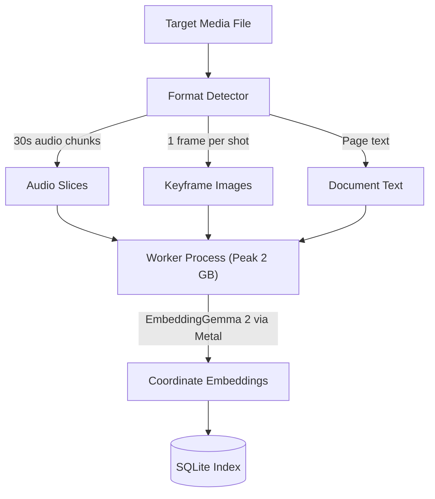
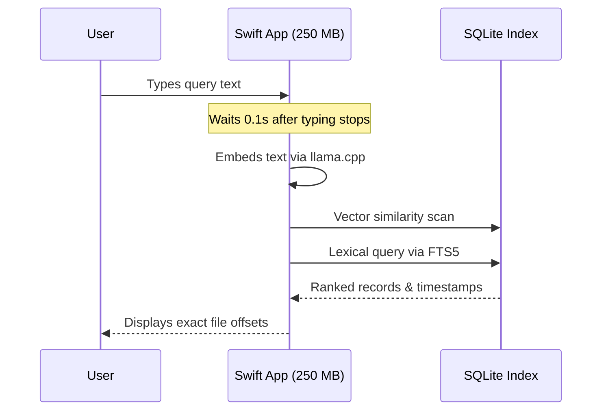
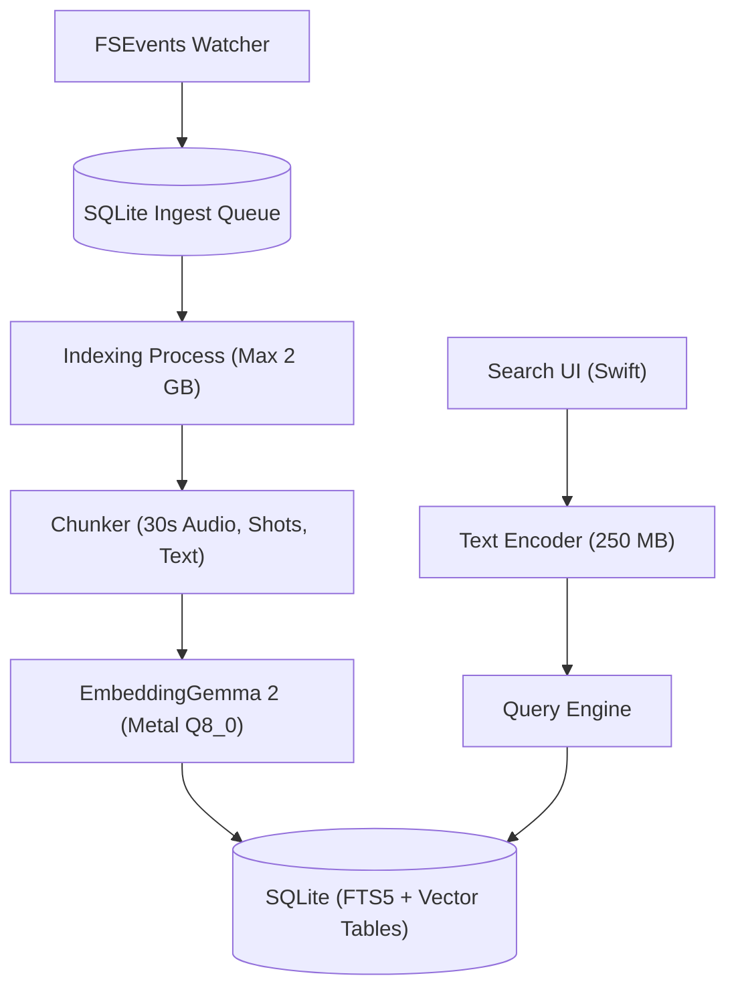

Packaging Google DeepMind's EmbeddingGemma 2 into an 865 MB Q8_0 GGUF binary lets an operating system map text, images, audio, and video into a single vector space without calling an external API. Searching that space surfaces results roughly a tenth of a second after a user stops typing, matching the responsiveness people expect from a native system utility while keeping private files on the machine.

Routing local file contents to cloud embeddings introduces round-trip network delays, bandwidth consumption, and data leakage risks. Once sensitive lease agreements, bank records, or internal codebases leave the host, verifying how downstream providers store or process that telemetry becomes impossible. Running embedding models on the workstation eliminates external exposure, but embedding heterogeneous desktop media inside end-user software requires tight control over memory usage and process lifecycles.

## Decoupling Search Latency from Media Ingestion

Multimodal models can easily exhaust desktop RAM if every encoder stays memory-resident. If an application keeps text, image, audio, and video projection networks loaded simultaneously, background operating system tasks and user applications will compete for unified memory.

The DigUp project addresses this constraint by splitting the runtime memory profile into two separate lifecycles. Query execution does not require projecting audio waveforms or image frames. It only requires projecting the user's search string. The application loads just the text encoder into memory, which occupies roughly 250 MB. The query is embedded through llama.cpp with Metal acceleration on Apple Silicon. Because this footprint is small, the search interface can stay resident in memory continuously without triggering memory pressure or system paging.

Indexing has a much higher compute requirement. Decoding video files, slicing audio tracks into 30-second windows, extracting one frame per shot, parsing document pages, and generating embeddings pushed peak memory under 2 GB during DigUp's ingestion workloads. Instead of running these workloads inside the primary UI process, the ingestion engine runs in an isolated helper process. When the batch indexer finishes walking the targeted directories, the helper process exits completely, returning all allocated pages back to the operating system.


*Figure: The indexing helper isolates media ingestion and exits after writing vectors to SQLite.*

I think process isolation is mandatory for any desktop AI utility. Running heavy media extraction inside the main application loop invites memory fragmentation, and long-running tensor allocations will gradually degrade desktop responsiveness even after indexing pauses.

## Multimodal Alignment Across Heterogeneous Media Formats

Unifying text, imagery, and audio within a single coordinate system removes the need for separate metadata pipelines. Traditional desktop indexing relies on textual transcription, optical character recognition passes, and file tags before any query can run. When the underlying vector space is shared, natural language descriptions retrieve non-text media directly.

In DigUp, searching for a phrase like "zebra in a video" directs the player to the exact moment the animal appears. Searching "where they talk about sleep" jumps to the specific minute of a recorded podcast, and "a dog on the beach" surfaces photos matching the scene. Because EmbeddingGemma 2 projects multilingual tokens into this unified geometry, the same photo query submitted in Bengali or Arabic retrieves the identical asset. For software development tasks, prefixing a search with code syntax can pinpoint the target function directly in an editor.

This cross-modal alignment shifts the processing cost from search time to ingestion time. Slicing audio into 30-second windows and sampling video at one frame per shot creates a predictable stream of chunks that map directly to timeline offsets. When a user executes a search, the dot product between the query vector and stored media vectors resolves to a concrete timestamp or document page without intermediate heuristic scoring.


*Figure: Interactive queries bypass media decoders and scan SQLite directly with the compact text encoder.*

## Dual-Engine Retrieval in a Single SQLite File

Specialized vector databases add operational baggage to client software. Running a standalone database daemon consumes background CPU, adds installation hurdles, and introduces IPC overhead for what should be simple file lookups.

A plain SQLite database handles both vector storage and lexical retrieval cleanly. DigUp stores its data at `~/Library/Application Support/DigUp/index.noindex/index.sqlite`. Keyword filtering runs straight through SQLite's built-in FTS5 extension. When a user runs a strict keyword search, the system bypasses the neural network and queries FTS5 directly. When semantic discovery is needed, the text encoder generates a vector to evaluate similarity across stored embeddings in the same database file.

Using standard SQLite files keeps client software open to automation. A user or script can query the database directly using the sqlite3 CLI in read-only mode, or call the application's command-line interface helper directly at `/Applications/DigUp.app/Contents/Helpers/digup search "your words" --json`. This architecture preserves user ownership over the index without custom export utilities or proprietary container formats.

## Client-Side Redaction and Ingestion Guards

Desktop file indexes often ingest sensitive text, including contracts with Social Security numbers, internal roadmaps, and medical statements. If an application architecture incorporates optional cloud synchronisation or external LLM analysis, sending raw document strings outside the local boundary compromises security.

National Design Studio's Rampart project approaches this by shifting PII redaction directly into the local client before any payload can leave the machine. Operating inside the browser using WebGPU, Rampart pairs deterministic rules with a small MiniLM model. Structured data such as credit card numbers, phone numbers, routing information, and government IDs are evaluated by regular expressions paired with algorithmic validation checks. Unstructured entities like personal names and street addresses are parsed by MiniLM.

The entire Rampart model and tokenizer measure 14.7 MB, delivering a p50 latency of 3.9ms in the browser. In benchmarks on a 30,000-row held-out OpenPII test set across seven Latin-script languages, this combination achieved 98.42% recall. By comparison, cloud-based AWS Bedrock Guardrails reached 63.8% recall on the same test set, and Microsoft Presidio scored 65% with a ~13 MB footprint. OpenAI Privacy Filter reached 97.4% recall, but requires a ~2.8 GB model download that would take roughly 38 minutes on a 10mbps connection.

```typescript
import { createGuard } from "@nationaldesignstudio/rampart";

const guard = await createGuard();

const safe = await guard.protect(
  "My name is John Wick. I live at 88 Cedar Lane, Brookvale, CT 06482."
);

console.log(safe.text);
// "My name is [GIVEN_NAME_1]. I live at [BUILDING_NUMBER_1] [STREET_NAME_1], Brookvale, CT 06482."
```

I'm not convinced that a 98.42% recall rate is sufficient for enterprise settings where zero data retention is mandatory. As critics pointed out, regex checks over arbitrary strings do not provide absolute determinism, and missing sensitive tokens in uncurated text still constitutes an information leak. For local-first desktop workflows, however, keeping data on the machine eliminates that transmission risk altogether. Local redaction serves best as a defensive pre-filter before writing text into shared or synced caches.

## Draft design

Assume a developer search tool indexing 50,000 local files (PDFs, code repos, voice memos, screenshots) on an Apple Silicon laptop, with a hard memory budget of 3 GB during active indexing, an idle memory target under 300 MB, and an interactive query latency under 150ms.


*Figure: The FSEvents queue separates continuous change detection from the isolated batch embedder and read-only search UI.*

| Option | When it wins | Cost / risk | 
| :--- | :--- | :--- |
| **Local EmbeddingGemma 2 (Q8_0) + SQLite FTS5** | Desktop search requiring multimodal recall across photos, video, audio, and text with zero network dependence. | Requires an 865 MB initial model download; indexing audio and video causes high CPU and GPU load during batch ingestion. |
| **Cloud Multimodal API (Embeddings via HTTP)** | Thin clients with minimal compute and minimal disk space where background battery preservation takes priority. | Variable network latency on slow uplinks; external data leakage risks; ongoing API token costs scale with file volume. |
| **OS-Native Keyword Indexing (Spotlight / FTS-only)** | Pure text and metadata lookups where users remember exact file names or specific strings. | Misses non-text media (audio, video, unlabeled images) and cross-lingual conceptual queries. |

### Open questions

1. What is the sustained battery drain of running 30-second audio window slicing and Metal video frame extraction on a laptop running on battery power?
2. How severely does vector search latency degrade in SQLite without a specialized vector index once the stored record count exceeds 500,000 vectors?
3. Can the 14.7 MB Rampart MiniLM model be extended beyond Latin-script languages to match EmbeddingGemma's cross-lingual coverage in Bengali and Arabic?

I'd start by profiling the file extraction step before tuning model quantization. In local desktop indexing pipelines, raw disk reads, PDF layout parsing, and video frame decoding usually bottleneck throughput long before tensor calculations reach the GPU.
