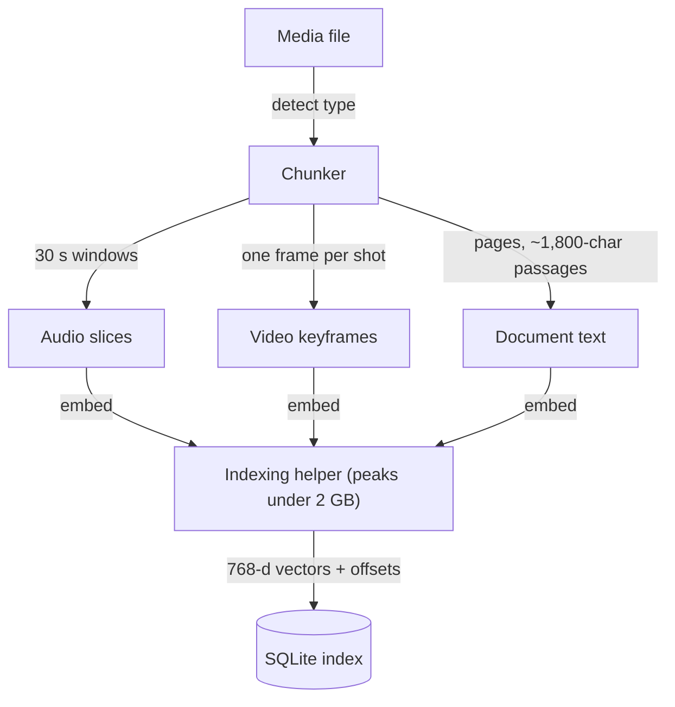
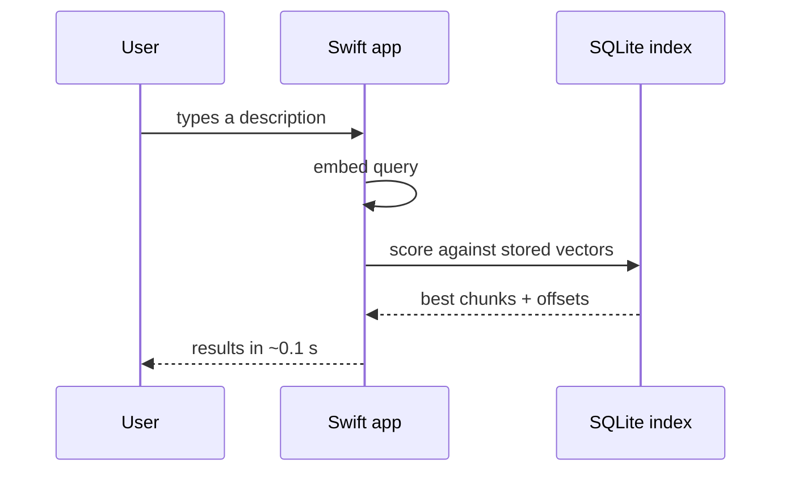
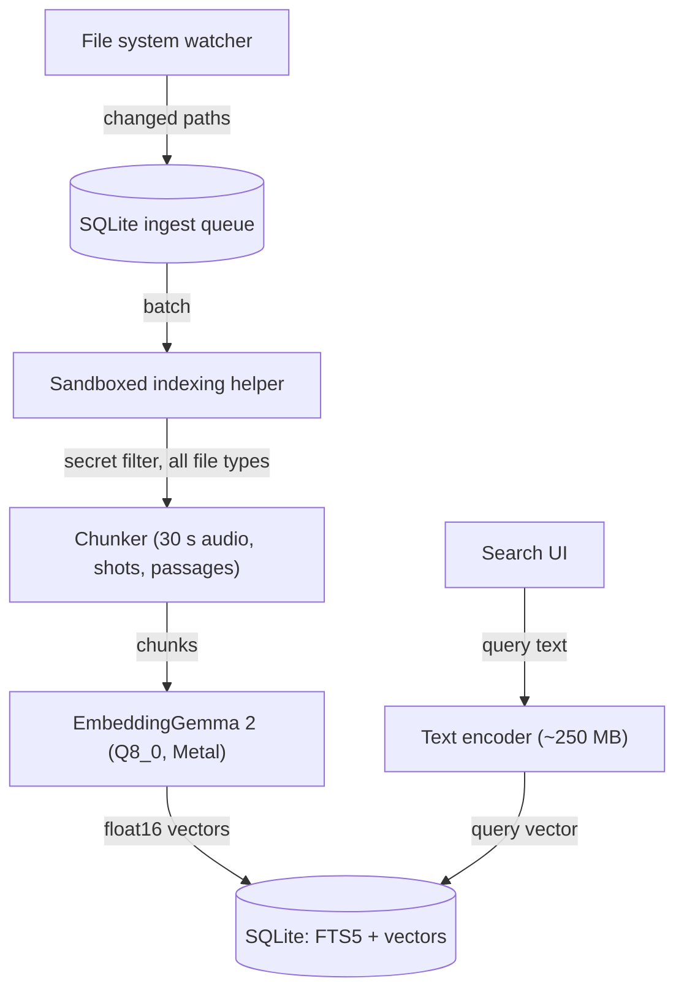

DigUp, an open-source Mac app, packages Google DeepMind's EmbeddingGemma 2 as an 865 MB Q8_0 GGUF and uses it to put text, images, audio and video from your own folders into a single vector space. You describe what you remember, and results show up about a tenth of a second after you stop typing. Nothing is sent to an API: the network is only used to download the model once and for an update check you can turn off.

That combination is what makes local semantic search practical rather than a demo. Cloud embeddings mean shipping lease agreements, bank statements and private code to someone else's servers and taking their word for how it's stored. Running the model on the laptop removes that question, but it moves the hard part onto your machine: memory, background work, and an index you now have to protect yourself.

## Decoupling Search Latency from Media Ingestion

The app splits its work into two lifecycles with very different costs. Answering a query only requires embedding the search string, so searching loads just the text encoder, about 250 MB. It runs through llama.cpp with Metal inside a native Swift app, with no Python involved. That footprint is small enough to keep the search path responsive.

Indexing is the expensive half. Audio and video of any length go in as 30-second windows and one frame per shot, documents are split into pages and roughly 1,800-character passages, and each piece is embedded. According to the author, indexing peaks under 2 GB, and the helper that does it exits when it's done.

*Figure: Every chunk carries its file and offset into the index, and the helper process exits once indexing finishes.*

I think a separate, short-lived indexing process is the right default for any desktop AI tool. The heavy work happens in bursts, and when the helper exits, its memory goes back to the system instead of lingering behind a search bar you use a few times a day.

## One Vector Space for Every File Type

Putting every format into the same space removes the transcription, captioning and tagging passes a traditional pipeline needs before anything is searchable. In DigUp, "zebra in a video" opens the clip at the moment the zebra shows up, "where they talk about sleep" jumps to that minute of a podcast, "the clause about pets in the lease" opens the PDF page with your words marked, and "a dog on the beach" finds the photo. The same search in Bengali or Arabic finds it too. With code search turned on, "code: retry with backoff" opens the matching function in your editor.

The chunking is what makes those jumps possible. Each page, passage, keyframe and 30-second audio window gets its own 768-dimensional vector, and the best-matching chunk wins, which tells you the page or the moment as well as the file. The author points out that this also sidesteps the model's input limits: a two-hour recording is never one input.

Screenshots get both treatments. They receive an image vector, since the model reads the text in them, plus Apple's OCR for exact words.

*Figure: A query never touches the media decoders, only the small text encoder and the stored vectors.*

## No Vector Database Required

The part I like most is what DigUp leaves out. Each vector is stored as float16, 1.5 KB apiece, and search is brute force: the query vector is scored against all of them in float32. The author reports that takes a few milliseconds for tens of thousands of vectors, "so no vector DB."

For a single user's files, I'd make the same call. A vector database server on a laptop is another daemon to install, start, update and keep healthy, and an approximate index buys you nothing when an exact scan already fits inside the time it takes to lift your fingers off the keyboard.

Everything lives in one SQLite file at `~/Library/Application Support/DigUp/index.noindex/index.sqlite`. Keyword search works straight from `sqlite3` because it's FTS5. Meaning search needs the model, and the app already ships a CLI for that at `/Applications/DigUp.app/Contents/Helpers/digup search "your words" --json`. The author recommends opening the database read-only, since the app writes to it. Your index stays a file you can inspect, script against, or delete.

## The Index Is Now the Sensitive Part

Keeping files local doesn't make the index harmless. It's a searchable summary of everything you pointed it at, so what goes in matters as much as where it lives.

In the same thread, a commenter who read the source found a concrete gap. The secret filter, `isSecret()`, ran for code search but not for regular document indexing, so a file like `secrets.txt` in a selected non-code folder could still be indexed. They suggested fixing the filter, protecting the index, and sandboxing the file-processing helpers to limit the damage if a parser is ever compromised. The app uses the hardened runtime but not App Sandbox. The author agreed and said a fix was on the way, along with keeping the index out of Time Machine backups.

I'm not convinced a filter alone is enough here. Parsers for PDFs, video and archives are exactly the code you want isolated, and a short-lived helper process is already halfway to a sandbox. I'd make sandboxing the indexing helper the first change, ahead of any work on search quality.

## Draft design

Assume a developer search tool indexing 50,000 local files (PDFs, code repos, voice memos, screenshots) on an Apple Silicon laptop, with an idle memory target under 300 MB and interactive queries that should feel instant while typing.

*Figure: The secret filter runs before chunking for every file type, inside a sandboxed helper that exits after each batch.*

| Option | When it wins | Cost / risk |
| :--- | :--- | :--- |
| **Local EmbeddingGemma 2 (Q8_0) + SQLite with brute-force search** | Mixed media, offline use, and users who want results that jump to the page or moment. | 865 MB one-time model download; CPU and GPU load during indexing; the index itself becomes sensitive data. |
| **Cloud multimodal embeddings over HTTP** | Thin clients with little disk or compute where battery matters more than privacy. | File contents leave the machine; network latency on every query; costs grow with the number of files. |
| **Keyword-only search (Spotlight or FTS5 alone)** | Users who remember exact file names or exact phrases. | Misses audio, video, unlabeled photos and cross-language queries. |

### Open questions

1. At what number of stored vectors does brute-force scoring stop feeling instant, and is that point ever reached by one person's files?
2. Which folders should be excluded by default, given that a secret filter only catches what it recognizes?
3. How much battery does indexing hour-long audio and video cost when the laptop isn't plugged in?

I'd start by putting the indexing helper in a sandbox and moving the secret filter in front of every file type. A local index that quietly holds your `secrets.txt` defeats much of the point of keeping things local.
