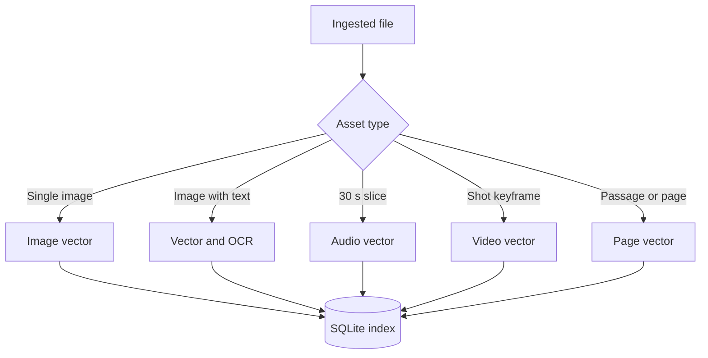
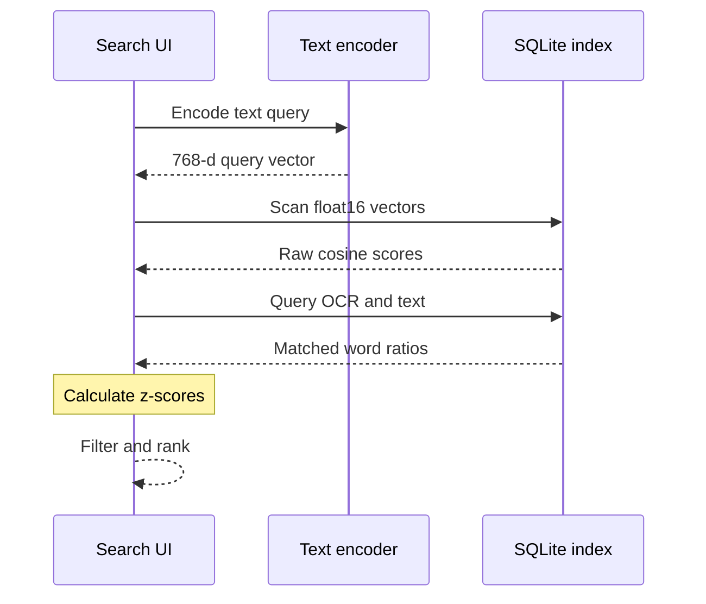
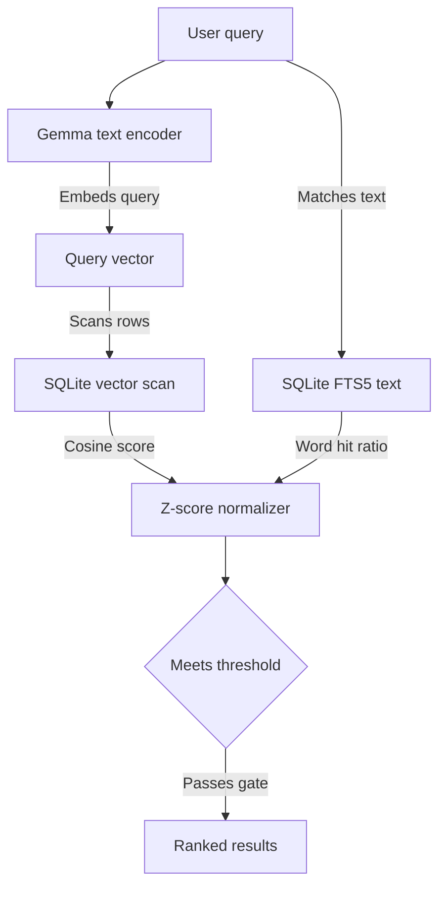

A quantized 865 MB model running on consumer hardware can map desktop text, photos, audio clips, and video keyframes into a shared 768-dimensional vector space. In DigUp, an open-source macOS search app built on llama.cpp with Metal, Google DeepMind's EmbeddingGemma 2 runs as an 8-bit Q8_0 GGUF. When someone searches, the application loads only the text encoder, which occupies roughly 250 MB of memory. It runs a brute-force vector scan across tens of thousands of items stored in SQLite and presents matching results about a tenth of a second after typing stops. The search panel itself opens in 20 ms, and the app idles at 15 to 30 MB of RAM.

Offloading personal file search to cloud-hosted multimodal embedding APIs introduces recurring token bills, network latency, and privacy issues. Running the text encoder and cross-modal embeddings locally cuts those external dependencies entirely. The technical trade-offs shift instead to disk footprint, chunking boundaries, SSD write wear, and the mathematical mechanics of merging keyword matches with dense vectors.

## Media storage costs versus text expansion

Multimodal indexing behaves counter-intuitively when comparing dense media against plain text. High-resolution images and long video streams are cheap to store as vectors, whereas plain text and scanned documents drive index growth.

DigUp stores every chunk as a 768-dimensional float16 vector, taking 1.5 KB per record. Media files chunk cleanly without massive text bloat:

- Photos generate one 768-dimensional vector, taking about 1.6 KB on disk.
- Screenshots take around 3 KB, which covers the 768-dimensional image vector alongside Apple's OCR text.
- Audio is split into 30 s windows, adding up to roughly 0.25 MB for an hour of recording.
- Video is indexed as one keyframe per shot every few seconds, generating 1 to 2 MB of index data per hour of footage.

Text documents require substantially more storage because a multi-page document cannot be collapsed into a single vector without destroying fine-grained retrieval. DigUp chunks text into passages of roughly 1,800 characters and indexes each PDF page separately, using around 6 KB per page. A 300-page book takes about 2 MB of vector and keyword index space. Across 100,000 photos, the index footprint reaches roughly 160 MB. Across 200 hours of video, it needs 200 to 400 MB. In contrast, documents take two to three times the size of their original plain text once vectors and inverted indices are stored.


*Figure: Ingestion chunks media into fixed time windows or visual keyframes, storing each slice as a 1.5 KB vector in SQLite alongside extracted text.*

During indexing, peak memory stays under 2 GB, and the helper process exits when indexing finishes. For daily use, macOS filesystem events notify the app when watched directories change. The app waits for file activity to settle, compares file sizes and timestamps, and reads only modified or newly created files. Build folders, dependency directories like node_modules, caches, archives, and system files are skipped entirely. SSD wear is negligible because reading files causes no flash degradation, and incremental writes average only a few kilobytes per added item.

## Why reciprocal rank fusion degrades multimodal results

Standard search pipelines often rely on Reciprocal Rank Fusion (RRF) to merge keyword scores with semantic vector rankings. In DigUp's evaluation on 380 files (consisting of 146 screenshots, 30 PDFs up to 463 pages, an hour of audio, and 8 videos), RRF actively degraded retrieval quality. Across a synthetic evaluation set, RRF reached a top-1 accuracy of 0.73 compared to 0.88 for score fusion. On real files across 111 queries plus 68 code queries, RRF achieved 0.82 compared to 0.86 for score fusion.

I think RRF is the wrong tool for multimodal search because it throws away the magnitude of individual matches. RRF treats rankings as simple ordinal lists. If a user searches for an error message, an irrelevant terminal screenshot that happens to contain one matching word can seize the top ordinal rank in BM25, displacing an architectural chart that matches the semantic intent of the query. Pure semantic retrieval has the opposite failure mode. On DigUp's testbed, the vector model alone found only 5 of 9 exact lookups like error codes. Combining keyword scores with vectors located all 9.

Raw cosine similarity cannot be used with a fixed threshold across mixed media. DigUp's author noted that cosine similarities sit in a compressed band: unrelated items score around 0.55 to 0.60, while strong matches score between 0.67 and 0.86. The score baseline also shifts depending on the query string. To solve this, DigUp calculates a per-query z-score across candidate matches.

```python
def score_match(cosine: float, modality_mean: float, spread: float, 
                query_words: set[str], doc_words: set[str], 
                names_kind: bool, is_id_query: bool) -> float:
    z_score = (cosine - modality_mean) / spread
    matched_ratio = len(query_words & doc_words) / max(len(query_words), 1)
    keyword_score = 2.0 * (matched_ratio ** 1.5)
    
    if names_kind:
        keyword_score += 1.0
        
    if is_id_query:
        return (0.5 * z_score) + (2.0 * keyword_score)
        
    return z_score + keyword_score
```

A candidate enters the result set only if its semantic z-score reaches at least 2, or if the file contains at least half of the query's words. In tests comparing centering techniques across 105 queries, centering each modality against a single shared spread placed the target result first in 94 queries. Raw cosine without centering achieved 92, and calculating a separate spread per modality achieved 91.


*Figure: The search pipeline loads the text encoder, executes brute-force cosine comparisons in SQLite, and normalizes scores before filtering.*

## In-memory scans and storage considerations

Running brute-force linear scans inside SQLite runs counter to standard vector database advice, but I am not convinced that small local tools need specialized vector databases. For tens of thousands of 768-dimensional vectors, computing float32 dot products in memory takes only a few milliseconds. DigUp avoids the operational complexity, background process management, and binary footprint of dedicated vector stores by storing embeddings directly in a single SQLite database file.

However, storing embeddings as float16 introduces technical trade-offs. One commenter highlighted that the EmbeddingGemma model card warns against storing vectors in float16 due to potential activation overflow and numerical degradation. In DigUp, storing float16 cuts the vector size to 1.5 KB per chunk. Dimension truncation offers another potential reduction. As a commenter pointed out, truncating dimensions cuts index footprint and memory consumption while retaining most of the native accuracy.

Filtering boundaries also present practical security concerns. DigUp excludes hidden files, symlinks, caches, and dependency trees. For code repositories, it checks an `isSecret()` filter to avoid indexing credentials. But as a commenter noted, that filter runs only on code paths. A file like `secrets.txt` located in an ordinary document folder can still be indexed because the filter checks filenames and extensions rather than inspecting unstructured document text or screenshots. An application indexing user files must apply security boundaries uniformly across all directories.

## Draft design

Assume an offline technical search tool for a developer laptop indexing 50,000 files (consisting of 25,000 code and markdown files, 15,000 architectural diagrams and screenshots, and 10,000 technical PDF pages) with a strict latency budget under 200 ms and memory usage under 1 GB during active search.


*Figure: The design fans out user queries to the quantized text encoder and FTS5, merging candidates through a per-query z-score gating stage.*

| Option | When it wins | Cost / risk |
| --- | --- | --- |
| Full 768-d float16 scan in SQLite | Collections below 100,000 vectors where operational simplicity and minimal binary size are primary goals. | Linear scan latency scales directly with corpus size; model card warns of possible float16 activation degradation. |
| Dimension-truncated vectors in SQLite | Disk-constrained environments or corpora exceeding 250,000 items needing reduced memory footprints. | Modest drop in native retrieval accuracy on domain-specific technical terminology. |
| Embedded ANN index (such as sqlite-vec) | Large collections exceeding 500,000 items where brute-force dot products exceed the latency budget. | Increased index build times, larger index files on disk, and graph indexing memory spikes. |

### Open questions
- Does storing EmbeddingGemma 2 embeddings in float32 rather than float16 yield measurable recall differences on technical code queries?
- How severely does dimensional truncation hurt retrieval for OCR text extracted from technical architecture diagrams?
- Can directory-scoped search use B-tree path prefixes in SQLite without skewing the cross-modality mean and spread calculations?

I'd start with full 768-dimensional vectors scanned linearly in SQLite before reaching for specialized vector indexing. When corpus size stays under 100,000 chunks, simple linear scans combined with score fusion deliver fast, private search without external service dependencies.
