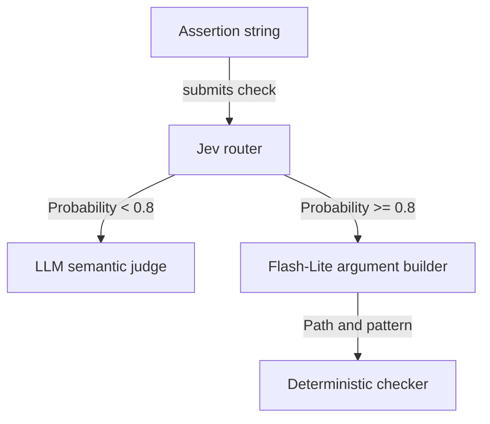
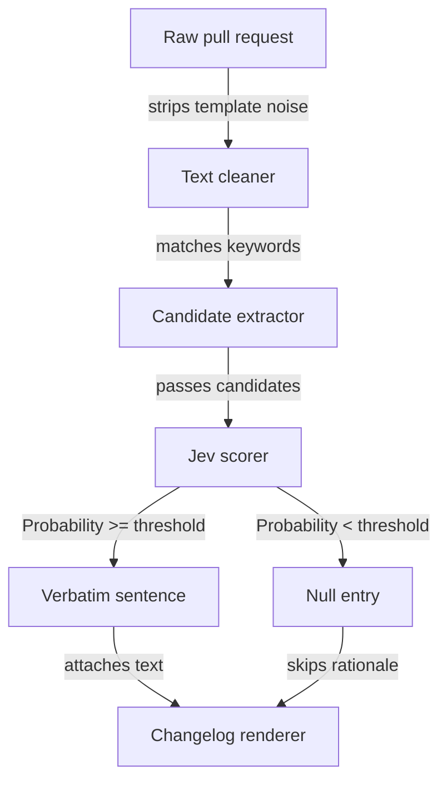
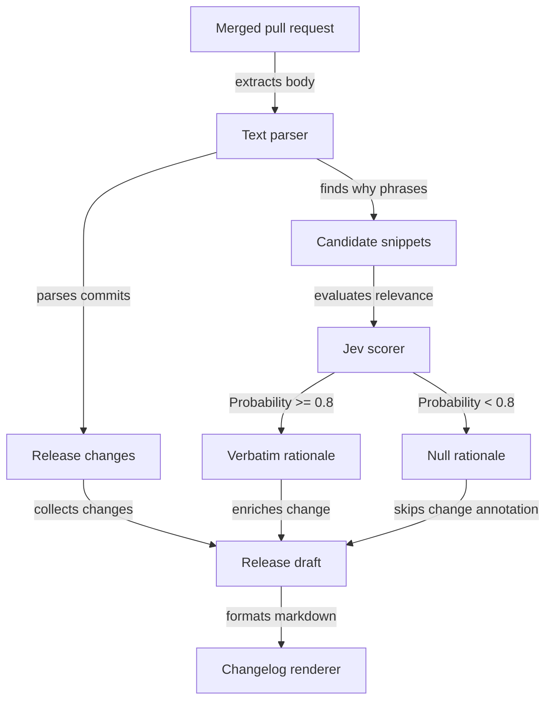

Routing an evaluation check through Opus 5.5 costs $1.18 per 1,000 checks, while pairing Jev with Gemini Flash-Lite drops that cost to $0.10. On larger models like GPT-5, that single-call routing price climbs to $2.42 per 1,000 checks.

Frontier reasoning models are often used to patch over loose system boundaries and vague prompts. When an unconstrained model receives an ambiguous instruction, it uses its broad pretraining to guess what the caller wanted. That guess looks intelligent, but it masks bugs in the pipeline definition. When you isolate classification from text generation, enforce boundaries with deterministic code, and evaluate candidates against strict mechanical criteria, lightweight models match frontier accuracy while cutting spend by an order of magnitude.

## The high cost of masking weak prompts

Frontier models forgive lazy specifications. In the benchspec project, which grades AI coding agents against markdown assertions, the author tested routing logic across several models. The router's job is straightforward: read an assertion and assign it to an exact mechanical checker like `regex` or `file_exists`, or defer it to an LLM judge when semantic interpretation is required.

Under a bare prompt without negative criteria, Gemini 3.8 Flash and Opus 5.5 produced zero false-positive routing errors. Gemini Flash-Lite, running the exact same prompt, failed roughly one run in five, mistakenly routing assertions that required semantic reading to simple regex checks.

I think reaching for Opus in that situation is the wrong reaction. A larger model conceals prompt defects without resolving them.

When the benchspec author refined the routing prompt to focus on checker blind spots, both large models shifted aggressively toward deferral. The update cut Opus's correct deterministic routing decisions by more than half, and Gemini 3.8 Flash stopped routing to mechanical checkers altogether. The heavier models did not gain better domain insight; their wider representations simply overcorrected toward caution when instructions narrowed. Flash-Lite costs $0.30 per million input tokens, while Jev costs $0.042 per million input tokens with free output. Running a frontier model to compensate for an unfocused routing prompt burns cash on compute that provides no extra structural reliability.


*Figure: Jev handles the initial routing branch, keeping Flash-Lite dark whenever a check defers to the judge.*

## Selection beats generation

Pipeline defects multiply when systems ask generative models to synthesize text that already exists in the input payload. In `changelog-bot`, the author wanted to extract the underlying rationale for a pull request rather than just summarizing its technical changes. Asking a language model to explain why a change was made invites it to paraphrase, synthesize, or invent motivations that the pull request author never wrote.

I'd start by eliminating generative prompts from any pipeline step where the source text already contains the target data. The `changelog-bot` author treated rationale extraction as a selection problem instead of a generation problem:

1. Deterministic regular expressions search for rationale markers like `because`, `so that`, and `motivation`, while pruning pull request template noise like checklists and markdown comments.
2. The code extracts raw candidate sentences from the body text.
3. Jev evaluates each candidate snippet against two questions: whether it explicitly states why a change happened, and whether that rationale applies to the target change.
4. If candidate probabilities clear both configured thresholds, the pipeline takes the candidate sentence verbatim. If none pass, the output records no rationale.

Here is how `changelog-bot` verifies candidate probabilities against its configured thresholds, based on the author's implementation:

```ts
const accepted =
  selectedCandidate !== undefined &&
  bestCandidate.probability >= JEV_MIN_EXPLICIT_WHY_PROBABILITY &&
  bestCandidate.relevanceProbability >= JEV_MIN_CHANGE_RELEVANCE_PROBABILITY;

if (!accepted) {
  return null;
}

items.push({
  prNumber: item.prNumber,
  why: selectedCandidate,
  confidence: mappedConfidence,
});
```

The output sentence is always the pull request author's original words. The model never writes prose. Deterministic string parsing builds the candidate pool, an inexpensive probability model scores the candidates, and strict thresholds discard anything uncertain. If a developer did not write a clear explanation, the pipeline accepts a null value rather than inventing plausible fiction.


*Figure: Candidate rationale text is isolated deterministically before the scoring model evaluates it, preventing text generation.*

## Two stages beat one monolithic call

Routing everything through a single completion model often costs more than chaining two specialized calls. On a slice of the Berkeley Function Calling Leaderboard (BFCL), standalone Flash-Lite achieved a 96.9% label accuracy with a 4.3% false-positive rate, writing arguments correctly 93.3% of the time for $0.257 per 1,000 items. Jev alone produced a 94.6% label accuracy, but because it only outputs probabilities over predefined options, it cannot write arguments at all.

Pairing Jev with Flash-Lite produced 96.4% label accuracy, lowered the false-positive rate to 1.1%, and wrote correct arguments 92.0% of the time, all for $0.101 per 1,000 items. On the benchspec dataset, standalone Flash-Lite cost $0.52 per 1,000 checks, while the Jev into Flash-Lite combination cost $0.10 per 1,000 checks.

Two structural factors explain why adding a model hop slashes the total bill.

First, the second model only fires when there is actual work to do. In the benchspec routing setup, fewer than four in ten checks have deterministic arguments for Flash-Lite to write. The rest defer to a judge. When Jev routes an assertion to the judge, Flash-Lite never runs.

Second, the second model receives a drastically smaller payload. Standalone Flash-Lite requires an extensive prompt with worked examples to keep its classification safe on edge cases. When Jev has already made the routing decision, Flash-Lite only needs the check string, the assigned checker name, and a short schema describing the target arguments. The input tokens drop to roughly one seventh of the original prompt.

The paired approach adds latency for items that require argument generation (689 ms for the pair versus 261 ms for Jev alone on BFCL), but it cuts total spend by more than half while reducing dangerous false positives.

## Tune failure modes instead of adding examples

When small models misclassify inputs, teams often default to stuffing more worked examples into the prompt. I'm not convinced that adding more examples to a prompt is ever the right fix when a classifier misbehaves.

In benchspec, adding worked examples to Jev's prompt doubled its dangerous false-positive routing decisions. Examples encourage superficial pattern matching. A check containing "a line that says X" matched the phrasing of the `regex` examples, so Jev routed it to the regex engine even when the assertion required reading for semantic context.

The author eliminated Jev's false positives by replacing examples with a single operational test: "Imagine the checker runs and passes. Could the check still be false? If yes, that checker is wrong: defer." Small decision models read prompts literally. The benchspec author updated the criteria definitions from descriptive shapes to hard mechanical boundaries:

- Old regex rule: The assertion says a named file has a line matching a stated pattern or literal prefix.
- Rewritten regex rule: Tests whether one named file has a line matching a pattern. It cannot tell what the matched text means or refers to.

Defining the mechanical blind spots of each tool brought Jev to zero false-positive runs across both training assertions and previously unseen test assertions.

Small models also fail differently under load. Jev exhibits clear blind spots: it will get the exact same edge case wrong every time until you fix the prompt criteria. Flash-Lite exhibits sampling noise: on loose criteria, it gets a check wrong roughly one run in five and right the other four. A blind spot is a prompt bug you fix by redefining boundaries; sampling noise is an architectural trait you address through explicit downstream validation.

## Draft design

Assume an automated release pipeline processing 15,000 merged pull requests a day, where latency must stay under a second and downstream costs must stay predictable.


*Figure: Deterministic parsing creates candidates, Jev scores them, and the changelog renderer formats the accepted text.*

| Option | When it wins | Cost / risk |
| --- | --- | --- |
| Frontier Zero-Shot (e.g. Opus 5.5 or GPT-5) | Unstructured source text where creative prose synthesis is required. | Costs $1.18 to $2.42 per 1,000 checks; high risk of hallucinating author intent. |
| Flash-Lite Monolith | Workflows requiring extraction and argument parsing on almost all inputs. | Costs $0.257 to $0.52 per 1,000 checks; subject to sampling noise on loose criteria. |
| Jev Selection + Flash-Lite Validation | High-volume pipelines where most inputs need filtering, routing, or verbatim extraction. | Costs $0.10 to $0.101 per 1,000 checks; adds about a quarter of a second of latency when the second hop runs. |

### Open questions

1. What is the optimal probability cutoff for Jev across diverse team repositories? In `changelog-bot`, a contributor expanded the benchmark corpus from 14 to 50 test cases to evaluate precision and recall across a sweep of thresholds from 0.4 to 0.9. A similar sweep on internal pull requests is needed before setting a production threshold.
2. When Flash-Lite generates structured arguments for mechanical checkers, does schema enforcement through response formats resolve the cases where argument generation misses the target schema (where standalone Flash-Lite achieved 93.3% on BFCL)?
3. At 15,000 pull requests a day, what proportion of changes contain verifiable rationale markers, and does candidate extraction yield high enough recall to skip fallback generation entirely?

Before swapping in an expensive frontier model to fix pipeline defects, write explicit criteria covering your tools' blind spots and test whether splitting selection from generation solves the problem first.
