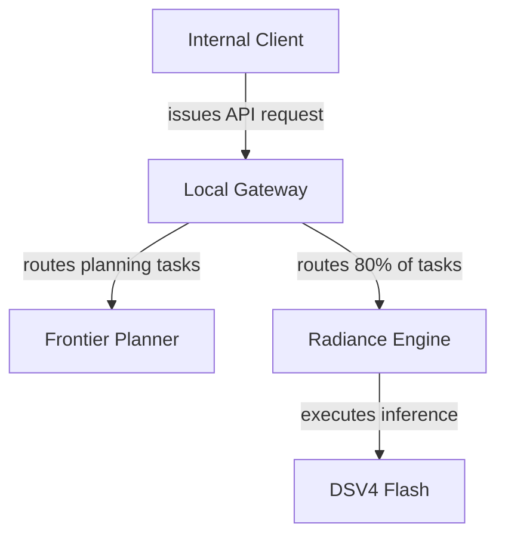
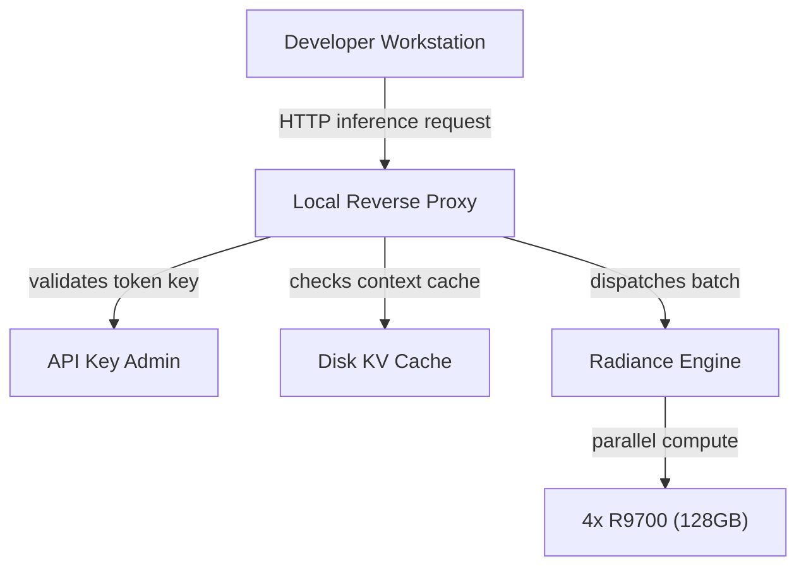

A multi-GPU build described by a system builder cost $18k, packing four AMD Radeon R9700 AI Pro 32 GB cards into a single tower. The build pairs those cards with a Threadripper 9970x processor, 128 GB of DDR5 ECC 5600 memory, and a Seasonic TX 1600 Prime power supply.

I think buying dedicated hardware upfront beats paying metered API bills once developers start running agent test loops all day. I think when API calls are billed per token, developers hesitate to run evaluations, test long contexts, or let background agents iterate. I think a dedicated box removes that friction entirely.

## Power constraints and the nine-month payoff

 In this setup, undervolting keeps each card below 210W, so the machine runs on a standard 15A or 20A outlet.

Power capping leaves throughput within 1% to 3% of maximum performance. Under continuous load across two weeks of testing at eight hours a day, all four GPUs stayed below 90 degrees Celsius.

The builder calculated roughly nine months to break even, noting that using OpenRouter prices the rig generates $2-$3k worth of tokens per month. I find that payback timeline realistic if an engineering group actually exercises the machine with continuous test suites.

## Serving models and routing traffic

The system runs a fork of Radiance to serve Qwen 3.8 Next flash, Qwen 3.8 27b, and DSV4 Flash. The setup includes an internal dashboard to load models alongside a local API gateway for generating admin keys.

*Figure: The local API gateway directs 80% of routine traffic to local DSV4 Flash execution while reserving planning calls for frontier models.*

The builder reported routing 80% of requests to DSV4 Flash locally, pairing that workhorse model with a frontier planner for harder tasks. The client avoided Mac Studio machines because they wanted on-device sandboxes, persistent caching support, and massive storage.

## Context limits and KV cache capacity

On Qwen 3.8 27b in MXFP4, the rig handles 16 concurrent sessions with aggregate prefill of 6.3k to 6.8k tok/s. Aggregate decode spans 80 to 900 tok/s across contexts between 4k and 128k context each. Handling 16 users at 128k context each yields a time to first token between 5 and 10 seconds.

For Qwen 3.8 Next flash in int4fp8 at 48k context per user, aggregate prefill reaches 6,880 tok/s with decode at 538.5 tok/s. At 128k context per user, prefill drops to 3,050 tok/s and aggregate decode hits 365 tok/s.

The builder kept BF16 KV cache across all tests. One commenter noted that running an FP8 KV cache provides about 1,000,000 tokens of cache capacity across the GPUs, while running BF16 cuts that pool to half of that 1M. I think keeping BF16 KV cache is the right call for internal developer tools, because degraded cache precision causes subtle logic errors during tool calling and schema generation.

## Draft design

Assume an engineering team of 10 developers generating 3 million tokens per day in background integration tests and code agent loops, operating under a 2-second time-to-first-token budget and a strict $20,000 hardware cap.

*Figure: The reverse proxy validates internal developer tokens and checks cached context states before dispatching compute requests across the four GPUs.*

| Option | When it wins | Cost / risk |
| --- | --- | --- |
| Dedicated 4x R9700 workstation | Steady daily test suites and automated coding agent loops | High upfront capital expense, requires local hardware maintenance |
| Metered cloud inference | Irregular usage with low aggregate daily token counts | Zero upfront cost, but variable monthly billing and shared cloud queue latency |
| Rented cloud GPU instance | Temporary, intensive fine-tuning jobs lasting a few days | Ongoing hourly charges that exceed workstation purchase costs within months |

### Open questions

- How significantly does sustained thermal buildup degrade decode speeds when batch runs extend past 12 consecutive hours?
- Can the Radiance memory allocator dynamically evict inactive weights without spiking time to first token for concurrent developers?
- Will upcoming open-weights reasoning models fit inside 128 GB of combined memory while retaining uncompressed KV caches?

If I were setting up this machine, the first thing I'd benchmark is concurrent KV thrashing under 16 parallel agent sessions. Once you see where latency falls off a cliff, you can set hard concurrency ceilings in your reverse proxy.
