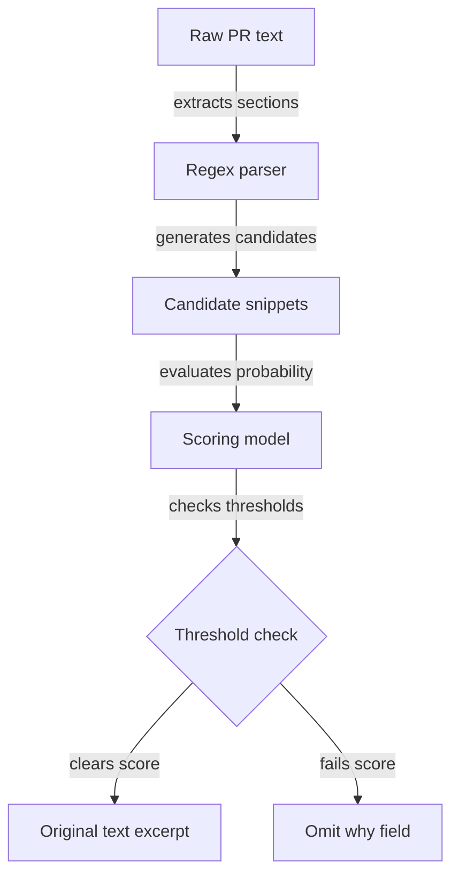
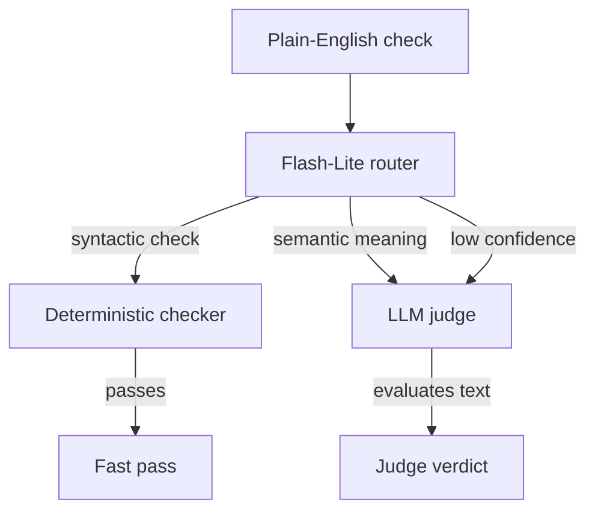
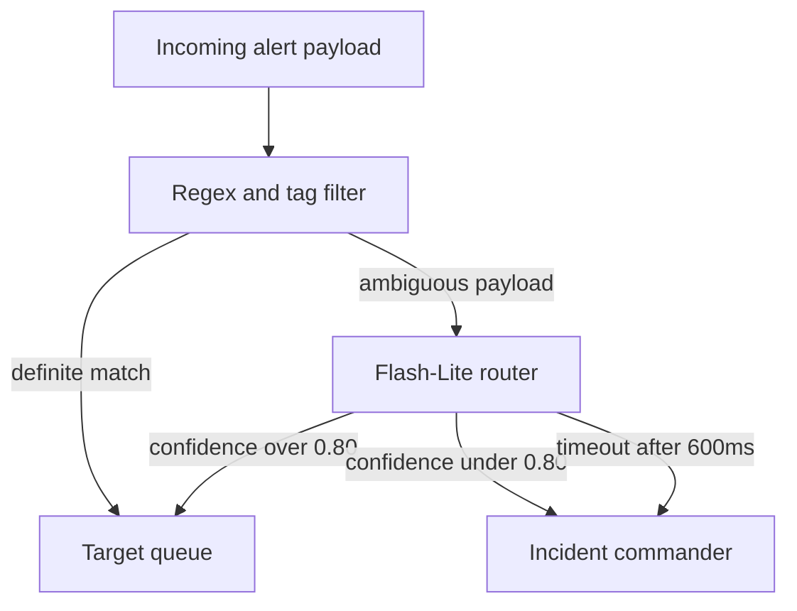

Asking a frontier model to classify an incoming event turns a selection problem into a text generation risk. When a generative model receives an open-ended classification prompt, it produces a fluent response regardless of whether the source text supports the premise. That behavior creates a subtle operational failure: the model hallucinates reasons, smooths over ambiguities, and conceals bad routing decisions behind convincing prose.

Building dependable classification pipelines requires stripping away open-ended generation. Small inference models, specialized probability scorers, and deterministic code filters beat generalist frontier models on triage tasks. They run in hundreds of milliseconds, cost pennies per million tokens, and fail explicitly rather than inventing plausible answers.

## Turn Generation into Candidate Selection

The standard approach to automated triage sends raw input into a large model and asks for a classification, summary, or root cause. That design treats classification as an authoring task.

Consider the problem of extracting the rationale behind a pull request into a release note. In `changelog-bot`, extracting what changed in a codebase is straightforward, but isolating why it changed invites severe model hallucination. If you hand a complete pull request description to an LLM and ask why the change was made, the model paraphrases text, infers missing intentions, and manufactures motivations that the committer never wrote.


*Figure: Preprocessing restricts the model to scoring existing snippets rather than authoring new prose.*

The solution is reframing the pipeline from generation to selection. Before any model invocation occurs, heuristic preprocessing inspects the raw text. It isolates candidate snippets using section headers like `why`, `motivation`, `context`, and `rationale`, alongside regex markers like `because`, `so that`, and `in order to`. Checkbox templates, markdown boilerplate, and irrelevant lines get stripped out immediately.

Once the system isolates candidate snippets, the inference engine never generates prose. It only scores each candidate against two explicit questions:

1. Does the candidate explicitly state why this change was made?
2. Does that reason apply to the specific change being cataloged?

A decision model like TypeSafe's Jev returns calibrated probabilities for each candidate across those two dimensions. The pipeline applies strict thresholds to the resulting scores:

```typescript
const accepted =
  selectedCandidate !== undefined &&
  bestCandidate.probability >= JEV_MIN_EXPLICIT_WHY_PROBABILITY &&
  bestCandidate.relevanceProbability >= JEV_MIN_CHANGE_RELEVANCE_PROBABILITY;

if (accepted) {
  items.push({
    prNumber: item.prNumber,
    why: selectedCandidate,
    confidence: mappedConfidence,
  });
}
```

If a candidate passes both minimums, the pipeline accepts the author's original sentence verbatim. If no candidate clears the bar, the field remains empty. That omission is the correct engineering outcome. An empty field preserves system accuracy, whereas an invented justification silently corrupts the output.

## The Asymmetric Cost of Triage Errors

In triage and routing systems, classification mistakes carry unequal penalties. The cost of over-caution is measured in small financial overhead; the cost of overconfidence is broken trust.

This exact tension appears in `benchspec`, an open-source evaluation runner developed at Major League Hacking to grade autonomous coding agents. The runner evaluates plain-English checks specified in markdown files:

- `./.meta/index.md exists`
- `Exactly six files match ./.meta/templates/*.md`
- `The summary faithfully reflects the three key facts from the source`

Each check runs through one of two verification paths. Cheap, deterministic code checks verify file presence, run globs, and match regex patterns. These local checks execute instantly for zero marginal cost. Alternatively, an LLM judge reads the artifact and grades semantic alignment. That judge call costs money on every execution.


*Figure: The router sends syntactic checks to code and routes semantic or ambiguous checks to the judge.*

The router reading each check faces two error modes:

1. It sends an assertion to the LLM judge when deterministic code could have verified it. You lose fractions of a cent on an unnecessary API call.
2. It sends an assertion requiring semantic interpretation to a regex or file-existence checker. The naive code check passes when the artifact is actually defective. A broken agent run registers as a green build, and users ship broken software.

Wasted cents can be absorbed. Silent false positives destroy confidence in the verification pipeline. Therefore, the governing rule for triage routing is simple: when in doubt, defer to the heavier check.

Frontier models struggle with this posture out of the box because instruction-tuning pushes them toward providing decisive answers rather than declining or deferring. Compact models designed for classification fit the problem better. Gemini 3.5 Flash-Lite runs at $0.30 per million input tokens with a 1-million-token context window and answers in well under a second. In routing experiments run on `benchspec`, Flash-Lite produced zero false positives, opting to defer borderline cases to the judge rather than hazarding an invalid local check.

## Constraining Literal Decision Engines

Specialized decision models take latency and cost reduction further. TypeSafe's Jev reads an input and a fixed list of options, returning calibrated probabilities over those options without outputting natural language tokens. It costs $0.042 per million input tokens, with output tokens being free, and resolves in a few hundred milliseconds.

Specialized models can fail on subtle context when prompted naively. In initial routing runs on `benchspec`, Jev produced dangerous false positives on checks that appeared purely syntactic. For example, given the assertion "no `.DS_Store` anywhere", Jev selected a single-path checker instead of deferring. The single-path checker confirmed that one specific path was clear while leaving the rest of the repository uninspected. Similarly, it routed semantic text assertions to regex because the assertion mentioned specific keywords.

Decision models read literally. They score the exact question asked, not the implied intent. The fix is not providing lengthy chain-of-thought examples; it is injecting an explicit counterfactual negative constraint into the prompt:

> "Imagine the checker runs and passes. Could the check still be false? If yes, that checker is wrong: defer."

Forcing the model to evaluate the failure state rather than surface pattern matching eliminated the false positives. Once constrained by adversarial framing, compact models match the triage accuracy of generalist models while operating an order of magnitude faster and cheaper.

## Deterministic Baselines Before Model Enrichment

Placing an external API call on the critical path of an operational workflow introduces latency spikes, rate limits, and network partitions. When triage architectures treat an LLM as the primary execution engine, an API timeout breaks the entire system.

A more resilient architecture uses a deterministic-first pipeline where AI acts as an optional enrichment layer. The core workflow should produce a complete, syntactically valid result before invoking any model.

In the v1 architecture of `changelog-bot`, pull request changes pass through deterministic parsing to build an initial `ReleaseDraft`. The changelog is structurally complete and renderable at that baseline stage. The WHY extraction step runs subsequently as an optional hook. If the model endpoint suffers a latency spike, fails to respond, or returns probabilities below threshold, the pipeline drops the enrichment pass and outputs the baseline changelog.

Compact models make this decoupled pattern practical. A pipeline cannot comfortably run an enrichment pass inside a webhook or interactive CLI if the call consumes 4 to 8 seconds of reasoning time. A lightweight model like Flash-Lite or Jev returns an evaluation in 200 to 400 milliseconds. That sub-second turnaround lets you run enrichment passes within background workers, continuous integration loops, and event-driven consumers without blocking downstream operations.

## Draft design

Assume an automated customer incident intake system processing 40,000 incoming alerts per day. The pipeline must route each alert into one of 8 team queues or escalate to an incident commander, operating within a 1.2-second end-to-end latency budget.


*Figure: Heuristics handle obvious matches immediately, while Flash-Lite classifies ambiguous alerts with automated fallback to human triage.*

| Option | When it wins | Cost / risk |
| --- | --- | --- |
| Direct frontier model call | Low-volume prototypes where taxonomy changes hourly and team has zero engineering capacity for heuristics | High latency (2 to 5 seconds); high cost ($2.50 to $10.00 per million tokens); risk of hallucinated categories |
| Flash-Lite with heuristic guardrails | High-volume production pipelines with variable payloads requiring sub-second routing | Low cost ($0.30 per million input tokens); requires maintaining heuristic filters and schema validation |
| Specialized probability model (Jev) | Strict multi-class classification over fixed, well-defined route sets where generation must be prevented | Lowest cost ($0.042 per million input tokens); requires careful counterfactual prompting to avoid literal classification errors |

Open questions:
- What percentage of incoming alerts fall into the ambiguous tier under real production variance?
- What is the measured p99 latency of managed inference endpoints under burst traffic compared to a self-hosted small open model?
- Does drift in the underlying alert payload formats cause confidence scores to decay faster than rule-based regex updates?

Before wiring a multi-billion parameter model into a critical triage path, isolate candidate strings using plain code and evaluate them with a sub-second classifier. Constrained decision engines inside guarded pipelines produce more reliable systems than unconstrained generative models ever will.
