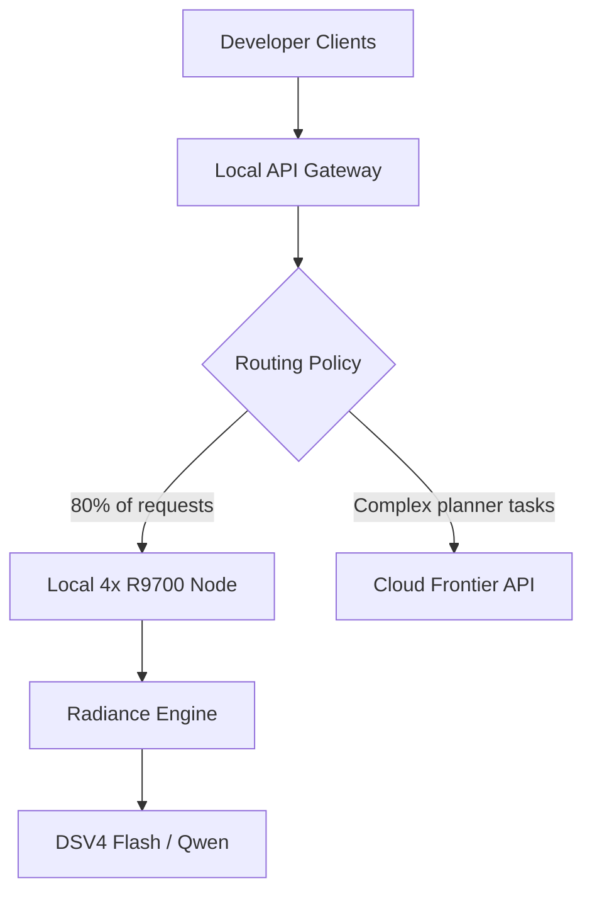
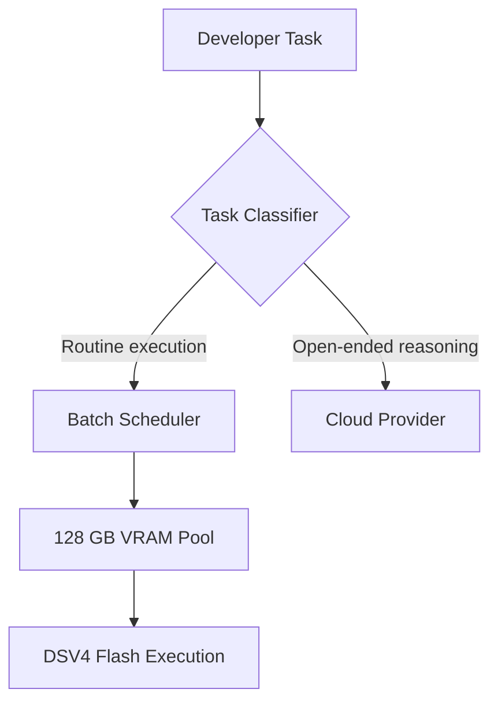
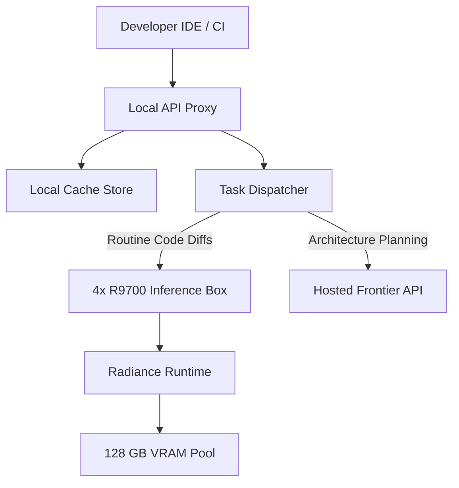

An $18k workstation running four AMD Radeon R9700 AI Pro cards can pay for itself in nine months against hosted model bills. When a 10-person engineering team burns through tokens on code review, context-heavy refactoring, and agent runs, relying entirely on shared cloud endpoints brings two persistent headaches: unpredictable generation latency during provider peak hours and monthly token invoices that scale directly with developer experimentation.

Putting dedicated silicon in an office flips that dynamic. Instead of paying per token to third-party model aggregators, you convert variable operating costs into a fixed capital expense. The economics become predictable, and the latency floor stops jittering based on another company's traffic spikes.

## The Economics of an Off-the-Shelf Workstation

The hardware required to replace continuous developer API usage is commercially available off the shelf. One setup built for a 10-person startup pairs an AMD Threadripper 9970x with 128 GB of DDR5 ECC memory at 5600 MHz and four AMD Radeon R9700 AI Pro cards. That configuration delivers 128 GB of aggregate VRAM. Powered by a Seasonic TX 1600 Prime power supply inside a Fractal Define XL chassis, the complete hardware bill landed at $18k.

*Figure: The local API gateway handles token routing, keeping high-volume execution on local silicon while passing complex planner prompts out to hosted cloud models.*

The investment calculation depends on baseline token burn. At OpenRouter prices, the builder noted that a typical 10-person startup runs through roughly $2k to $3k worth of tokens each month. Against that run rate, the break-even horizon lands at roughly nine months.

I think looking only at token parity actually understates the return. When tokens carry zero marginal cost after buying the hardware, engineers do not ration requests. They test more prompts, spin up broader automated evaluation sweeps, and chain multi-step agent tool calls that would otherwise get trimmed to keep cloud invoices under control. The real leverage comes from removing artificial budget ceilings on internal developer tooling.

## Splitting Planner and Executor Workloads

You do not need to host an enormous 400-billion-parameter model on-premise to replace hosted providers for daily tasks. The team using the 4x R9700 build routes 80% of its total request volume to DSV4 Flash hosted directly on the local machine. The remainder of the requests route to external frontier models in the cloud.

This architecture treats cloud endpoints as high-level planners and the local box as a high-throughput executor. The builder set up an internal admin gateway in front of the workstation that issues API keys and provides a dashboard to hot-swap models, functioning just like an internal drop-in provider for local services. When an IDE extension or continuous integration pipeline issues a task, the gateway sends parsing, small refactors, boilerplate generation, and retrieval extraction straight to the local R9700 cards. Only open-ended architecture prompts leave the building.

*Figure: Requests flow through classification logic so routine execution stays on local VRAM, preserving cloud credits for complex reasoning.*

Mac Studios are frequently proposed as office inference nodes because of their quiet operation and large unified memory pools. But the builder noted clear limitations with that path: Apple hardware cannot be upgraded, lacks modular PCIe expansion, and cannot support the on-device sandboxes, persistent caching architectures, or raw local storage setups needed for custom inference stacks. Standard workstation chassis offer modular expansion paths that proprietary unified systems cannot match.

## Concurrency and Context Throughput Under Load

A local inference node fails if it stalls when multiple engineers dispatch requests at the same time. The underlying execution engine dictates whether local silicon succeeds or fails under load. While early local setups used llama.cpp, continuous batching runtimes scale concurrent requests far more effectively. The 10-person setup runs a fork of the Radiance engine by StillDeadCode to serve models like Qwen 3.8 27B and Qwen 3.8 Next Flash.

The benchmark figures reported by the builder show how aggregate performance behaves under load using BF16 KV caching across all cards:

### Qwen 3.8 27B (MXFP4)
* Handles 16 concurrent sessions at context windows between 4k and 128k per user.
* Delivers 6.3-6.8k aggregate prefill tok/s across the pool.
* Time-to-first-token sits between 5-10s TTFT for 128k context depths.
* Aggregate decode ranges from 900 t/s down to 80t/s as context buffers fill.

### Qwen 3.8 Next Flash (int4fp8)
* At 48k context per user across 16 concurrent users, the rig sustains 6,880 tok/s prefill and 538.5 tok/s aggregate decode.
* At 128k context per user across 16 concurrent users, aggregate prefill reaches 3,050 tok/s and aggregate decode hits 365 tok/s.

Other community testing on Radiance with Qwen 3.8 Flash Next showed aggregate decode throughput between 580 and 600 tokens per second across 8 concurrent requests. Another community ROCm benchmark on two R9700 cards registered 216 weighted decode tokens per second and 565 prefill tokens per second, with an unquantized build achieving 200+ weighted decode and over 7,000 prefill tokens per second.

I'm not convinced that ultra-long context generation across multiple concurrent sessions is completely solved on local runtimes yet. As one community tester pointed out, multi-user generation speed exhibits a throughput decay bug in current software stacks when pushing context lengths out to 262k, dropping decode throughput down toward 10tok/s per user. But for everyday code review, automated testing, and diff inspection sitting well within 48k context lengths, 16 concurrent streams remain practical.

## Thermal Footprint and Office Power Constraints

Many engineering teams assume local multi-GPU systems require dedicated server closets, 240V circuits, and auxiliary cooling units. Running industrial server gear inside a shared office usually ends in noise complaints and tripped circuit breakers.

The 4x R9700 configuration avoids electrical overhauls through undervolting. Setting conservative power caps keeps each card under 210W. The builder reported that the power-capped GPUs perform within 1% to 3% of their stock ceiling while allowing the entire workstation, including the Threadripper CPU and peripheral components, to run safely on a standard 15A or 20A wall outlet.

Thermal management in the Fractal Define XL chassis relied on physical spacing rather than custom liquid loops. Over two continuous weeks of testing at eight hours a day under load, all four cards stayed below 90°C. The builder used riser cables to spread the physical cards apart, preventing heat from stacking between adjacent PCIe slots.

Power efficiency also compares well to competing silicon. One community tester running two R9700 cards alongside two RTX 5090 cards measured the R9700s pulling 215W while the 5090s drew 415W. The pair of R9700 cards delivered roughly 80% of the training output of a single 5090 while demonstrating roughly 50% better power efficiency. For office deployments where electrical supply and ambient heat output set hard constraints, efficient watt-per-token ratios matter far more than single-card peak benchmarks.

## Draft design

Assume a 10-person software engineering team generating consistent pull request reviews, test scaffolding, and continuous integration diagnostics. The workload currently generates roughly $2k to $3k in monthly cloud API expenses, requires support for up to 16 concurrent client connections, and operates within an initial hardware acquisition budget of $18k.

*Figure: The local API proxy checks local cache tables and dispatches incoming developer requests across the local 4x GPU cluster and external APIs.*

| Option | When it wins | Cost / risk | 
| --- | --- | --- | 
| Dedicated 4x R9700 workstation | High, steady monthly token consumption and predictable local concurrency needs. | $18k upfront CapEx; team must manage OS configuration and driver maintenance. | 
| Hosted commercial API endpoints | Early-stage products with irregular usage patterns and zero capacity for local hardware upkeep. | $2k to $3k monthly OpEx; variable generation latency during peak demand windows. | 
| Rented cloud GPU instances | Multi-week burst projects requiring rapid turn-up and turn-down without hardware depreciation. | Ongoing hourly compute bills, persistent egress fees, and ongoing networking overhead. | 

### Open questions
* Does the multi-user generate speed decay bug observed at 262k context get resolved in upstream Radiance releases?
* What throughput penalty does tensor parallelism incur across PCIe 4.0 risers compared to direct motherboard seating?
* How reliably does the ROCm runtime handle memory fragmentation during sustained BF16 KV cache reuse over weeks of continuous uptime?

I'd start by setting up a dual-GPU test machine running Radiance to validate your team's specific prompt templates and context depths before ordering a full four-card Threadripper build.
