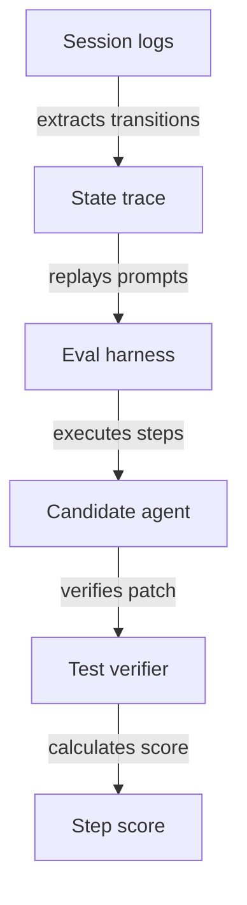

The introduction of AI coding agents leads to a 30 percent increase in total lines of code generated, yet the resolution rate for Issues and Epics tracked by tools like Jira does not change in a statistically significant way[^s2]. That divergence exposes the central flaw in how the industry evaluates coding agents. Standard benchmarks treat software development as an isolated, single-turn translation: take an issue description, emit a patch, and pass unit tests. If the patch passes, the benchmark records a success.

In real engineering workflows, generating lines of code is the easiest part of the job. Getting that code reviewed, verified, and safely merged is where teams spend their time.

## Review queues absorb code generation gains

When researchers Fiona Chen and James Stratton examined 300 million work events across more than 700 software firms, they observed that agents drove a 20 percent rise in total commits and a 23 percent increase in pull requests[^s2]. The generated volume did not translate into delivered software because it stalled downstream.

The average time between submitting a pull request and merging it into the codebase ballooned by 49 percent[^s2]. Pull requests required far more back-and-forth: the share of pull requests with changes requested nearly doubled, and comments per pull request grew by 35 percent[^s2]. To handle the review pileup, the share of workers performing code reviews grew by 14 percent[^s2].

I think optimizing an agent for isolated greenfield code generation optimizes the wrong metric. Flooding a codebase with raw code shifts verification debt onto human peers. Even though 80 percent of measured firms used some form of AI code review by March 2026, AI agents were responsible for only 23.3 percent of all review comments and 10.8 percent of all pull requests[^s2]. Human reviewers still shoulder the burden of finding bugs and edge cases.

## Real IDE sessions are multi-turn state machines

Engineers do not interact with IDE assistants through clean, one-shot instructions. A study collecting 4,782 agent sessions in JetBrains IDEs found that 33 percent of sessions had at least three user messages[^s1].

These sessions depart from issue-derived benchmark tasks in fundamental ways. User requests span a wide mix of task types, including questions about project code, planning, review, refactoring, and execution[^s1].

When researchers tested sequential multi-step task execution across 700 SWE-Bench Pro tasks, solving tasks sequentially in several steps approximately doubled agent cost without a stable change in resolve rate[^s1].

I am not convinced that single-turn benchmark scores indicate how useful an agent is inside an editor. An agent that aces isolated coding puzzles can easily burn double the tokens in multi-step dialogue without getting any closer to working software.

## Draft design

Assume an engineering group wants to benchmark coding agents across 20 internal services, handling an assumed 200 interactive developer sessions daily with an evaluation budget capped at $500 per month.

*Figure: Replaying interactive transitions tests whether an agent tracks repo context across sequential edits.*

| Option | When it wins | Cost / risk |
| --- | --- | --- |
| Single-shot issue eval | Fast initial filtering for syntax and API surface competence | Misses multi-turn drift and inflates real productivity expectations |
| Multi-turn session replay | Testing agent accuracy across interleaved question and refactor steps | Higher token spend per run; requires sanitizing recorded IDE telemetry |
| Synthetic task splitting | Evaluating repo context retention across stepped plans without private logs | Complex harness maintenance; synthetic branches may not match engineer habits |

Open questions:
- What percentage of multi-turn session failures stem from context-window truncation rather than model reasoning flaws?
- How much does prompt-level caching reduce the token cost of replaying long interactive traces?
- What heuristic best identifies when a developer abandons an agent response in IDE logs?

## Evaluating the edit loop

If you evaluate coding agents for your team, isolated issue pass rates tell only a fraction of the story. High completion rates on synthetic benchmarks will not prevent PR review queues from stretching by half or token costs from doubling when developers iterate.

I'd start by measuring the agent against sequential edit loops: record multi-turn developer sessions, replay those mixed-task traces, and measure how many revision cycles it takes to produce code reviewers can actually merge.

[^s1]: Coding-Agent Benchmarks Should Match Their Users' Task Flows, <https://huggingface.co/papers/2610.09633>
[^s2]: AI coding agents generate more code, but not more software, <https://arstechnica.com/ai/2026/10/ai-coding-agents-generate-more-code-but-not-more-software/>
