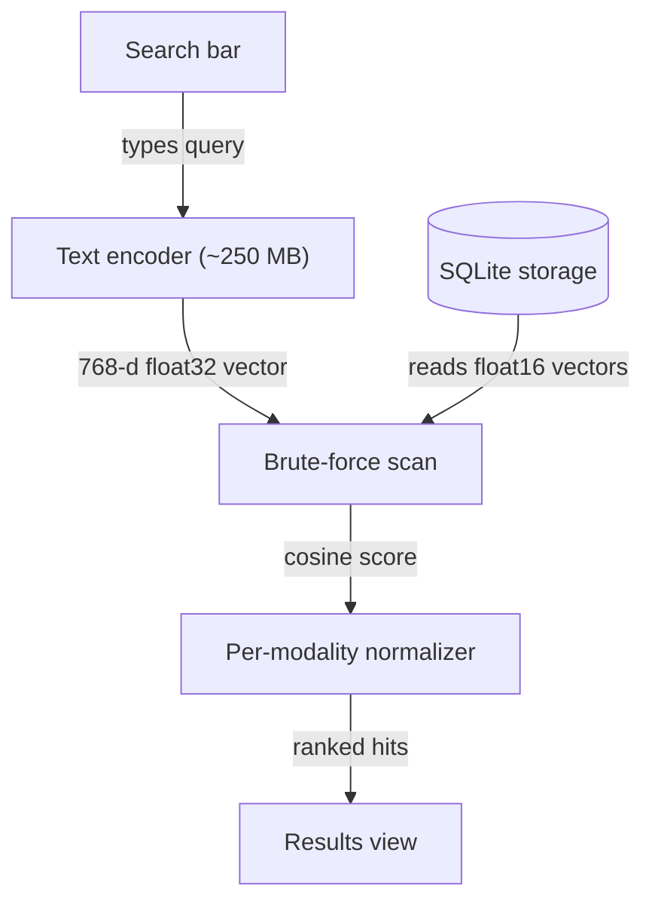
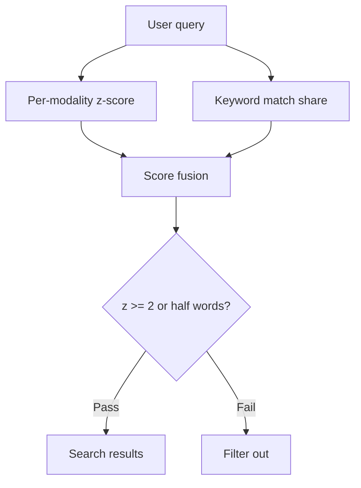
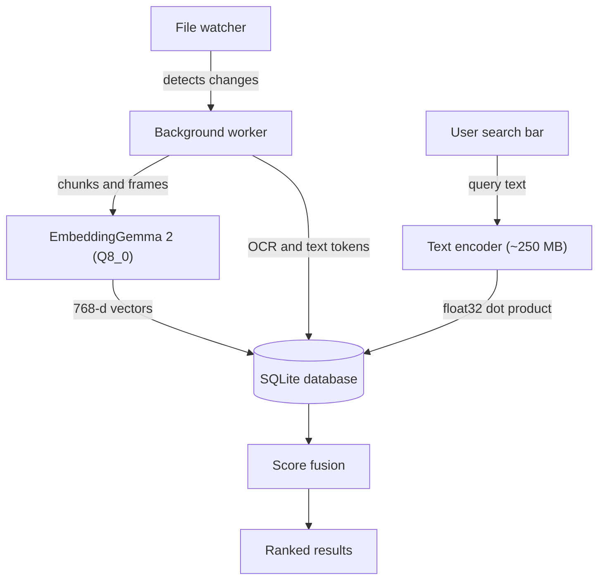

## Desktop semantic retrieval without remote infrastructure

Running Google DeepMind's EmbeddingGemma 2 locally inside an 865 MB Q8_0 GGUF on llama.cpp with Metal enables native desktop search across text, images, audio, and video. DigUp demonstrates that local files do not need an external ingestion pipeline or cloud embeddings. Indexing peaks under 2 GB of memory, and the helper process exits when finished.

### Scoring vectors directly in SQLite

I suspect engineers often reach for dedicated vector engines before measuring the scale of personal storage. DigUp stores every chunk as a 768-dimensional float16 vector (1.5 KB each) in a single SQLite file. Search runs as a brute-force scan where the query vector scores against all candidate vectors in float32, finishing in a few milliseconds across tens of thousands of items. At query time, the system loads only the text encoder, which uses roughly 250 MB of memory. The search panel opens in about 20 ms, and results appear around 120 ms after typing stops.

*Figure: The query engine loads only the text encoder at search time and scans stored float16 vectors in SQLite using float32 dot products.*

I think flat dot products in SQLite make sense for consumer file counts. The storage cost of media embeddings stays modest, as 100,000 photos generate roughly 160 MB of vectors, while 200 hours of video require 200 to 400 MB.

### Score fusion replaces rank fusion

My read is that pure vector search struggles on exact identifiers. In testbed evaluations on about 380 files, the embedding model alone found only 5 of 9 exact lookups like error codes, whereas combining the model with keyword matching found all 9.

DigUp tested Reciprocal Rank Fusion and discarded it because top-1 accuracy dropped from 0.88 to 0.73 on synthetic evaluations and from 0.86 to 0.82 on real files. Rank fusion discards the distance between candidate scores, which let unrelated screenshots with common words displace strong semantic matches.

*Figure: Raw cosine scores convert to per-modality z-scores before merging with non-linear keyword match weights.*

The author built custom score fusion instead. The semantic score calculates as cosine similarity minus the modality average for that query, divided by score spread, yielding a per-query z-score. The pipeline then adds twice the query word share raised to the 1.5 power, plus 1 if the query text explicitly names the media kind. A candidate enters results if its meaning z-score reaches at least 2 or if it matches at least half of the query terms. When queries resemble identifiers, keyword weight doubles while semantic weight is cut in half.

### Truncation trade-offs across modalities

I'd expect vector dimensional truncation to offer another lever for memory footprint. The author tested truncation across 111 file queries and 27 code queries by cutting stored vectors and renormalizing. Truncating from 768 to 512 dimensions degraded top-1 retrieval only from 98 to 97 correct files, with screenshots showing sensitivity before text. Code retrieval proved more fragile, dropping from 20 to 19 at 512 dimensions and collapsing to 16 at 256 dimensions.

I would avoid truncating dimensions unless RAM on low-end machines demands it. Scanning flat float16 arrays in SQLite already runs in a few milliseconds for tens of thousands of items. Sacrificing precision on code and screenshots to save half a kilobyte per vector is not a trade I would make.

## Draft design

Assume an offline desktop utility indexing 50,000 personal files on a user's laptop, with an interactive latency budget under 120 ms and zero outbound network calls.

| Option | When it wins | Cost / risk |
| :--- | :--- | :--- |
| **Flat SQLite (brute-force float16)** | Tens of thousands of items with low memory overhead. | Linear search scaling; requires SIMD or GPU dispatch on large personal collections. |
| **Embedded approximate nearest neighbor** | Large collections where linear scans exceed UI latency limits. | Index rebuild overhead, higher write amplification, and larger disk footprints. |
| **Cloud vector database** | Multi-user sync across enterprise storage environments. | Recurring API bills, remote network latency, and privacy leakage of private documents. |

### Open questions
- At what exact file count does brute-force float16 scoring on commodity laptop CPUs begin to lag human typing cadence?
- Can we selectively preserve 768 dimensions for code and screenshots while truncating document text passages to 512 dimensions?
- How should change detection handle network-attached storage when OS file notifications are unavailable?

Benchmark evaluations of vector truncation indicate that screenshots and code are most sensitive to dimension cuts, even if.
