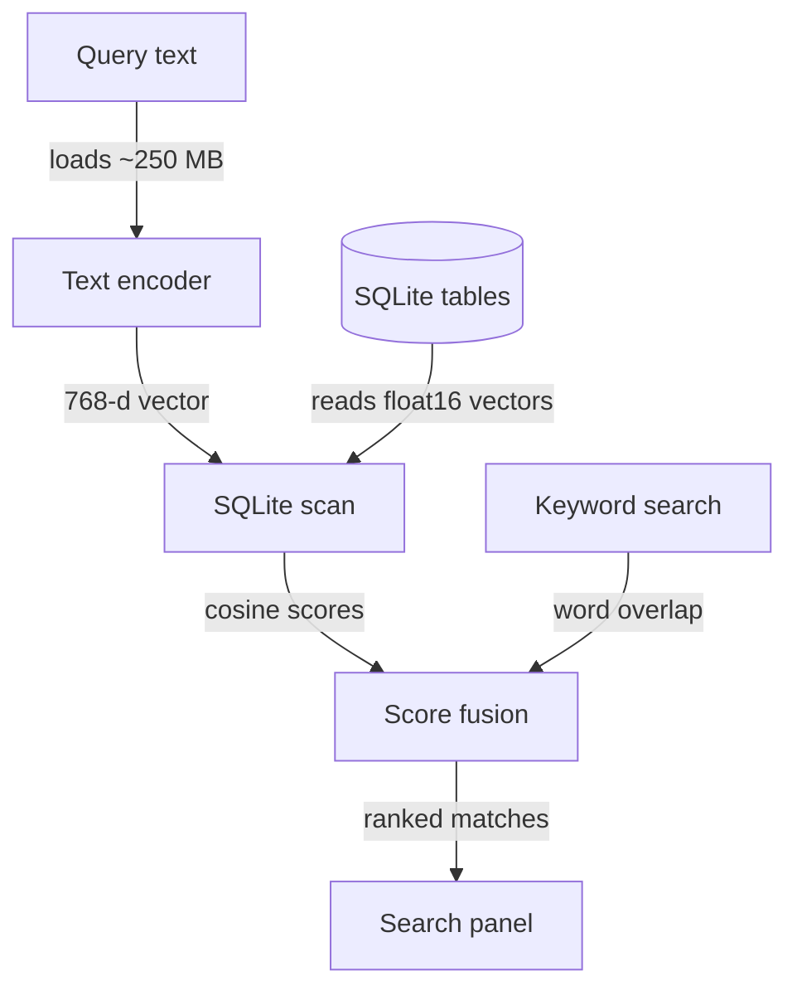
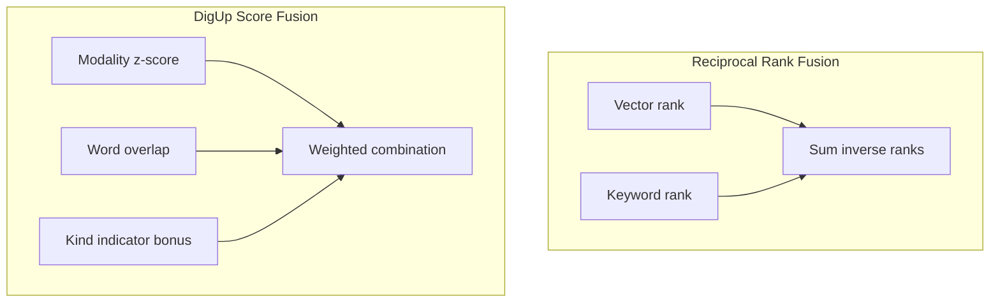
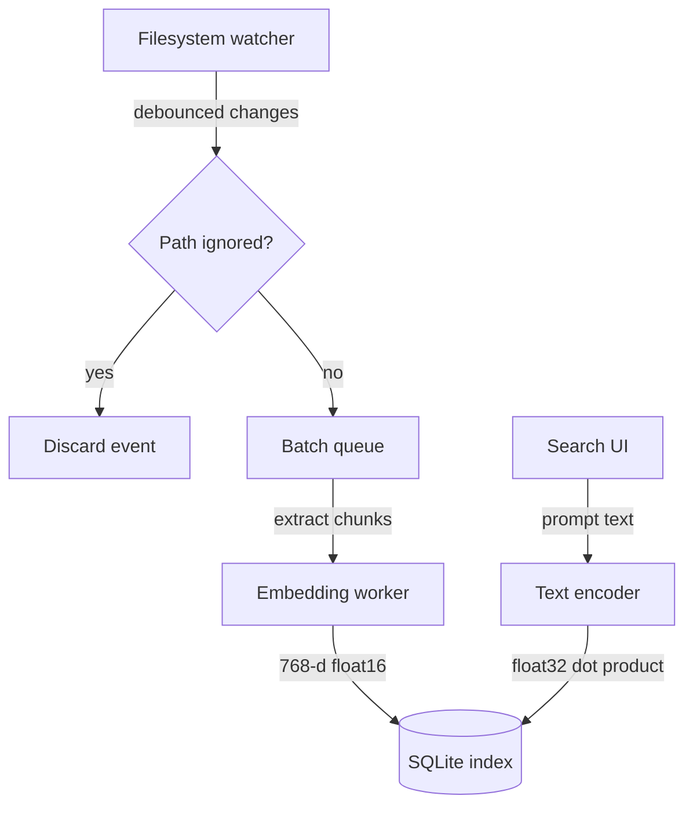

Running an 865 MB multimodal model locally gives you cross-modal file search without shipping private data to an external API.

In DigUp, an open-source Mac application, Google DeepMind's EmbeddingGemma 2 maps text, images, audio, and video into one shared space. A user can search "zebra in a video" to jump straight to that moment in a clip, or search in Bengali or Arabic to find a matching photo,. Long media files get segmented into 30-second audio slices and one keyframe per shot. The app runs entirely offline after downloading weights and checking for updates.

## Skipping the Dedicated Vector Store

I think spinning up a standalone vector database on a client machine is almost always premature. DigUp avoids dedicated vector stores entirely, holding its index in SQLite, though.

*Figure: DigUp scans stored float16 embeddings directly in SQLite, then combines semantic cosine distances with lexical word matches.*

Each photo, PDF page, ~1,800-character text block, video frame, and 30-second audio window maps to a 768-dimensional float16 vector taking 1.5 KB. Search runs as a brute-force scan: the query vector scores against every stored vector in float32, which takes only a few milliseconds across tens of thousands of items.

At query time, the app loads only the text encoder, which takes roughly 250 MB of memory. On the creator's machine, the search interface idles between 15 and 30 MB of memory, opens in about 20 ms, and shows results roughly 120 ms after typing stops.

## Score Calibration Over Rank Fusion

The DigUp creator evaluated RRF but opted for score fusion after finding. I'm not convinced rank fusion makes sense across distinct modalities; throwing away score magnitudes allows weak keyword hits to displace relevant semantic matches.

*Figure: Calibrated z-scores per modality keep dense semantic matches from being displaced by incidental keyword hits.*

To align modalities, DigUp normalizes cosine similarities by subtracting the modality average for the query and dividing by the score spread to get a z-score. Lexical overlap adds to that score with an exponent of 1.5. An additional point applies if the query specifies the media kind directly.

I think exact identifiers require lexical support. In the creator's tests, the semantic model alone resolved 5 of 9 exact lookups like error codes, whereas combining it with keyword search retrieved all 9. Queries matching identifier patterns weigh words double and meaning half.

## Managing Index Churn and Ingestion

I think an on-device index fails if it thrashes local storage or starves the CPU. DigUp keeps peak memory below 2 GB during indexing, and its background helper exits as soon as ingestion finishes.

Media embeddings stay relatively compact: 100,000 photos require about 160 MB of storage, and 200 hours of video take 200 to 400 MB. Individual media items take up little space, whereas.

DigUp skips repeated full scans by subscribing to operating system directory events, debouncing filesystem changes, and comparing file sizes and modification dates. Build artifacts, caches, and node_modules folders are ignored entirely.

## Draft design

Assume a personal desktop indexing tool monitoring 50,000 mixed files (documents, screenshots, and audio clips), budgeted for under 300 MB of idle RAM and sub-150 ms response times.

*Figure: The background indexer operates independently while the search interface accesses only the text encoder and the SQLite index.*

| Option | When it wins | Cost / risk |
| :--- | :--- | :--- |
| Brute-force SQLite scan | Collections up to tens of thousands of items; zero index structure overhead | Query latency grows linearly with total chunks. |
| Embedded ANN graph | Large collections where sequential dot products exceed the interactive response budget | Requires maintaining graph structures on disk and increases indexing time. |
| Truncating vectors to 512 dimensions | Storage-constrained setups needing smaller SQLite footprint | Small retrieval drop on visual content; code search accuracy drops slightly. |

### Open questions
- At what chunk count does the brute-force float32 dot product in SQLite degrade beyond interactive search speeds on low-power laptop CPUs?
- Does OCR extraction on screenshots deliver enough retrieval gains to justify the extra indexing time over relying purely on the visual embedding?
- How does background indexing affect battery drain when users import several hours of video at once?
