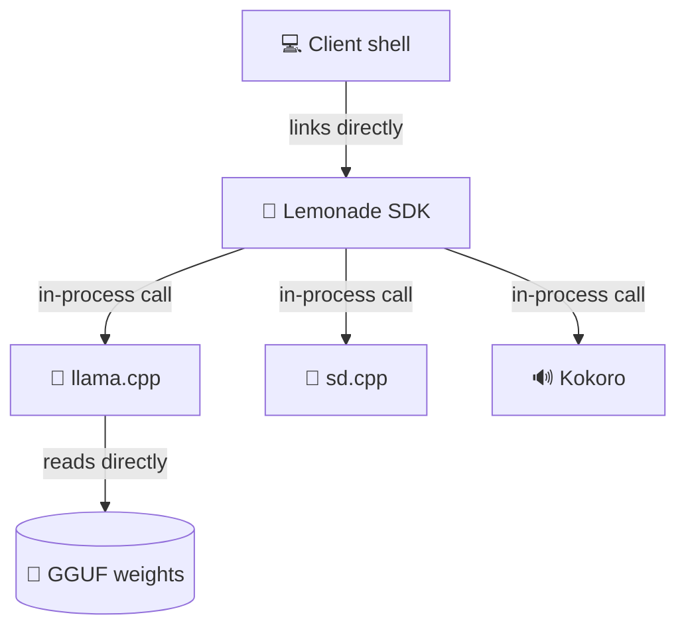
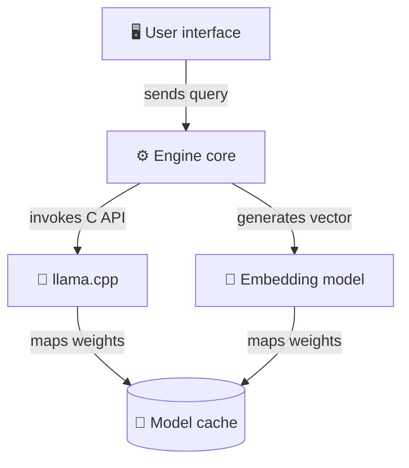

> **TL;DR**
> - AnythingLLM originally picked Ollama because "It was simply more convenient when you factor in Windows, Mac, Linux + all archs + GPU combos vs raw llamacpp."
> - The project migrated away to run models "without juggling a ton of third party apps and just using regular GGUF models and such."
> - Moving to an embedded engine also unblocks mobile delivery, where the team is "finally getting iOS support for local :)".

When AnythingLLM initially evaluated local inference engines, "llamacpp was still the functional backbone of local but ollama was easier to manage at the time". That early convenience was undeniable. A commenter on the team noted it was simpler because you had to "factor in Windows, Mac, Linux + all archs + GPU combos vs raw llamacpp.". I suspect wrapping inference inside a separate background daemon introduces an operational boundary that inevitably causes headaches for engineering teams.

## The background daemon tax

My read is that treating local inference as an external server turns what should be an in-process memory map into a distributed systems problem running on localhost. I'd expect that if the daemon crashes silently during context generation, the main application risks hanging while waiting on an unfulfilled streaming response.

I suspect daemons also impose frustrating storage behaviors on end users. One user complained about background runners downloading "600GB+ weights on sda or C:\ - That's the whole purpose of a storage, to not bloat your system drive and software should allow that as default.". My read is that when inference runs as an external service, overriding model paths or cache locations turns into an awkward configuration dance across different operating systems.

> I think bundling an external server daemon inside a client application is a shortcut that trades an afternoon of cross-compilation work for years of brittle process management.

## Direct runtime embedding

AnythingLLM chose to adopt the Lemonade embedded SDK to put their daemon migration behind them. The architectural shift unifies multiple model capabilities into a single address space: "Since Lemonade also has support for sd.cpp, kokoro, and all the other functionalities hopefully we can get full feature support so everyone can just start using all these features without juggling a ton of third party apps and just using regular GGUF models and such.". The team also plans to "upstream lemonade + llamacpp into the Docker image".

*Figure: The client links the embedded SDK in-process to run inference without background network daemons.*

I prefer dynamic linking over foreign function interfaces for client applications. I'd argue that the operating system handles lifecycle cleanup far more cleanly this way.

I'd expect embedding llama.cpp to ease cross-platform expansion as well, particularly on mobile. Tim noted their recent engineering focus includes "trying to get Android to a higher quality level + finally getting iOS support for local :)". Shipping a separate companion daemon on iOS seems completely impractical; direct compilation into the binary looks like the only sensible path.

Another commenter described loading separate small models of "0.6b in size" for tasks like speech-to-text, embedding, and reranking. I suspect coordinating multiple specialized helper models through an external daemon creates unwanted friction and latency. An embedded setup, by contrast, seems much better suited for keeping model contexts directly accessible in memory without HTTP communication overhead.

## Draft design

Assume a cross-platform desktop knowledge-base tool for 30k users that runs local 7B-parameter models alongside an embedded text-embedding model with a 150 ms query latency target.

*Figure: The application core controls embedded text and embedding inference runtimes inside its own process boundary.*

| Option | When it wins | Cost / risk | 
| --- | --- | --- |
| Embedded llama.cpp | Standalone desktop and mobile applications requiring zero user setup | Complex build toolchains across Metal, CUDA, and Vulkan targets |
| External daemon (Ollama) | Multi-application local setups where a persistent background server is already running | Port conflicts, orphan processes holding VRAM, and inflexible disk paths |
| Hosted cloud endpoint | Ultra-low-power client devices without discrete GPUs | Recurring inference bills, external latency, and loss of offline capability |

### Open questions
- How should the packaging pipeline manage fallback CPU builds when a user's graphics drivers fail Vulkan or CUDA initialization?
- What is the safest concurrency model to allow simultaneous execution of speech-to-text and chat generation without causing unified memory thrashing?
- How can in-process memory mapping handle corrupted weights without terminating the entire host application process?
