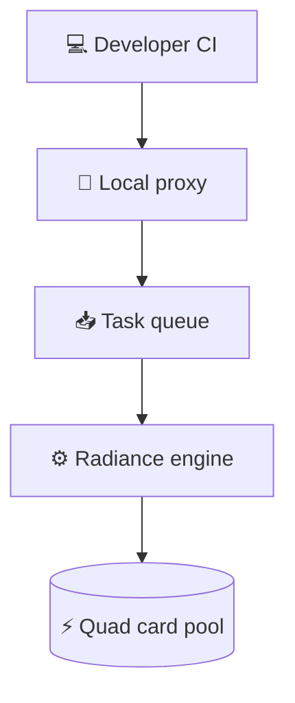

> **TL;DR**
> - An $18k build pairing four 32GB workstation GPUs provides 128GB of VRAM and handles 16 concurrent sessions.
> - Power-capping cards to under 210W retains performance within 1-3% of maximum while running off a standard 15A or 20A circuit.
> - Producing $2-$3k worth of tokens monthly against hosted prices puts the payback window at about nine months.

Metered API billing creates a quiet tax on development speed: when every continuous integration run, agent loop, and batch regression costs money, engineers start rationing their test runs. A custom workstation pairing an AMD Threadripper 9970X with four 32GB AMD Radeon R9700 AI Pro cards packs 128GB of total VRAM into a single box for $18k. The hardware acts as a fixed capital expense, turning variable inference bills into unmetered local compute.

## The nine-month payback window

One hardware builder tracked an $18k quad-GPU workstation deployed for a client, calculating that it generated $2-$3k worth of tokens every month based on public OpenRouter pricing. At that run rate, the entire hardware investment amortizes in roughly nine months.

The builder favored a frontier planner and local executor split, noting,.

> I think buying dedicated silicon beats paying meter rates the moment continuous test runs make engineers ration their queries.

Compact prebuilt machines like Mac Studios often look attractive for desktop serving, but they hit inflexible hardware limits. The builder noted that their client required a setup capable of hosting on-device execution sandboxes, persistent caching layers, and high-capacity local drives, none of which can be expanded on non-upgradable architectures. I think custom workstation boxes remain the only sensible path when your workloads demand raw storage expansion alongside high-density VRAM.

## Taming 840 watts on standard circuits

In this build, all four graphics cards were undervolted to stay below 210W apiece. Power-capping the cards avoids the need for dedicated electrical drops: the node operates safely on a standard 15A or 20A outlet while retaining within 1-3% of maximum factory output.

Under continuous eight-hour test loads across two weeks, GPU temperatures stayed below 90 degrees Celsius inside a Fractal Define XL enclosure. Power delivery required swapping to a Seasonic TX 1600 Prime unit after an initial Corsair HX1500i lacked enough PCIe slots to supply all four cards.

My read is that serving internal developers requires administrative infrastructure. The builder created an internal dashboard to load models and an API gateway that mints internal authorization keys, providing a local drop-in alternative to hosted provider endpoints.

Using a fork of the Radiance engine, the node serves models including Qwen 3.8 Next Flash and DSV4 Flash. At 48k context per user, aggregate prefill reaches 6,880 tok/s with 538.5 tok/s aggregate decode. At 128k context per user, throughput settles at 3,050 tok/s prefill and 365 tok/s decode. The deployment kept BF16 KV cache enabled across all models. I'm not convinced that moving to lower-precision KV cache formats is worth the risk of output quality degradation on production evaluation tasks.

## Draft design

Assume a ten-person product team running continuous CI regressions, batch evaluations, and local agent tasks amounting to 40,000 interactions daily, constrained by an $18k capex ceiling and a 500ms time-to-first-token goal for short prompts.

*Figure: Batch CI evaluations hit a prioritized local queue that feeds the quad-card inference pool without hitting external metering.*

| Option | When it wins | Cost / risk |
| :--- | :--- | :--- |
| **On-prem 4x 32GB node** | Steady local test suites and developer tool loops running all day | High upfront hardware cost; team handles physical maintenance and thermal layout |
| **Enterprise cloud API** | Traffic stays intermittent with long periods of zero queries | Zero hardware maintenance; usage bills scale linearly with evaluation runs |
| **Hosted dedicated GPU** | Ephemeral evaluation spikes requiring temporary short-term scale | High recurring rental fees; data transfer overhead for large prompt batches |

### Open questions
- How much does inference decode degrade when running mixed-precision KV cache instead of BF16 to expand concurrency limits?
- Will internal driver maintenance for non-standard GPU architectures add ongoing overhead during base operating system upgrades?
- Can riser cable spacing inside the chassis keep thermals stable if ambient room temperature rises during summer months?
