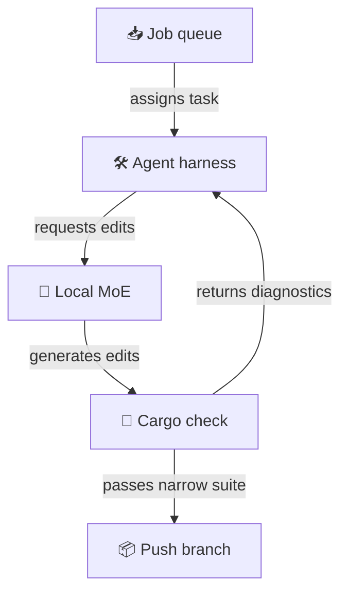

> **TL;DR**
> - In a 12-run trial on a real Rust repo, every PR generated by local Qwen3.8-Flash-Next and frontier Claude Opus 5.5 passed end-to-end tests.
> - Claude Code with Opus 5.5 averaged 82% on code reviews against 68% for Flash-Next, with the gap confined to edge cases, tests, and documentation.
> - Running Flash-Next locally on a laptop cost under 2 cents of power, compared to $17.78 for extra-high effort Opus on the identical task.

Every run across twelve trials successfully delivered a working feature on an actual Rust codebase, whether piloted by a closed trillion-parameter cloud giant or an open-weight model running on a consumer laptop. The prompt was not a toy puzzle from an interview site. It assigned a real feature from the LlamaStash roadmap: saving llama-server's KV cache before an unload and restoring it when the model returns. Across the generated pull requests, restoring a 15,000-token prompt cache dropped follow-up latency from 5.2 to 6.1 s down to about 1.4 s.

The author ran Qwen3.8-Flash-Next, a mixture-of-experts model with 125B total parameters and 6B active per token, on an Asus ROG Flow Z13 laptop. The machine held a 70W TDP ceiling throughout the benchmarks. The runtime engine, Halogen, sustained decode throughput of 51 to 56 tokens/s.

## The two-cent pull request

At commercial API rates, an extra-high effort Opus 5.5 run burned $17.78. Running Flash-Next locally cost less than 2 cents in wall power. I view Flash-Next like an eager apprentice working late with unlimited shop time, while Opus is an expensive consultant billing every minute on site. Flash-Next took 1.1x to 2.1x as long as Opus at matched effort tiers. On medium effort, Opus finished in 23.4 min, while Claude Code driving Flash-Next took 45.3 min. I'd accept that latency penalty every single day.

## Scaffolding beats raw weight

Opus averaged 82%, whereas Claude Code with Flash-Next scored 68% and Pi with Flash-Next scored 66%.

I think the agent harness matters just as much as model capability here. CI passed on 4 of 4 PRs for Claude Code driving Flash-Next, but on only 1 of 4 PRs for Pi driving Flash-Next. A solid harness acts like a rigid jig around a router, keeping a lightweight model on the cut line.

> I think paying cloud frontier prices for standard maintenance is wasteful when an open model with compiler feedback reaches the exact same working end state.

## The thinking ceiling

I am not convinced that throwing unlimited thinking tokens at smaller open models yields better outcomes. Opus jumped from 6.25 at medium effort to 6.94 at extra-high effort, though at 2.7x the cost. For Flash-Next, medium and extra-high scored essentially the same, and medium was faster across all pairs. 

My bet is that smaller active parameter sets hit a planning plateau where additional iterations circle rather than refine. As one commenter noted, a 3.0 bits-per-weight quantization of Flash-Next holds 99.4% of the BF16 benchmark average, so the gap to Opus comes from base model capacity rather than quantization loss.

## Draft design

Assume an internal maintenance runner addressing dependency updates and compiler warnings across 40 Rust services, with a $5 nightly budget and a 3-hour turnaround window.

*Figure: The local agent loops on cargo compiler errors directly before pushing changes to the repository.*

| Option | When it wins | Cost / risk |
| Frontier cloud API | Large structural refactors needing deep architectural reasoning | High API expense and vendor downtime dependency |
| Local MoE agent loop | Repetitive maintenance tasks bounded by compiler feedback | Higher wall-clock execution time and local RAM limits |
| Hybrid escalation | Local run executes first, escalating to cloud only after test failures | Higher harness orchestration complexity |

### Open questions
- What minimum prompt prefill rate on local silicon prevents harness step timeouts during large context expansions?
- How many compile-and-fix iterations does a lightweight open model average on complex borrow-checker errors compared to frontier models?
- Can automated prompt templates for test generation bring the local model's 68% code review average closer to the 82% mark?
