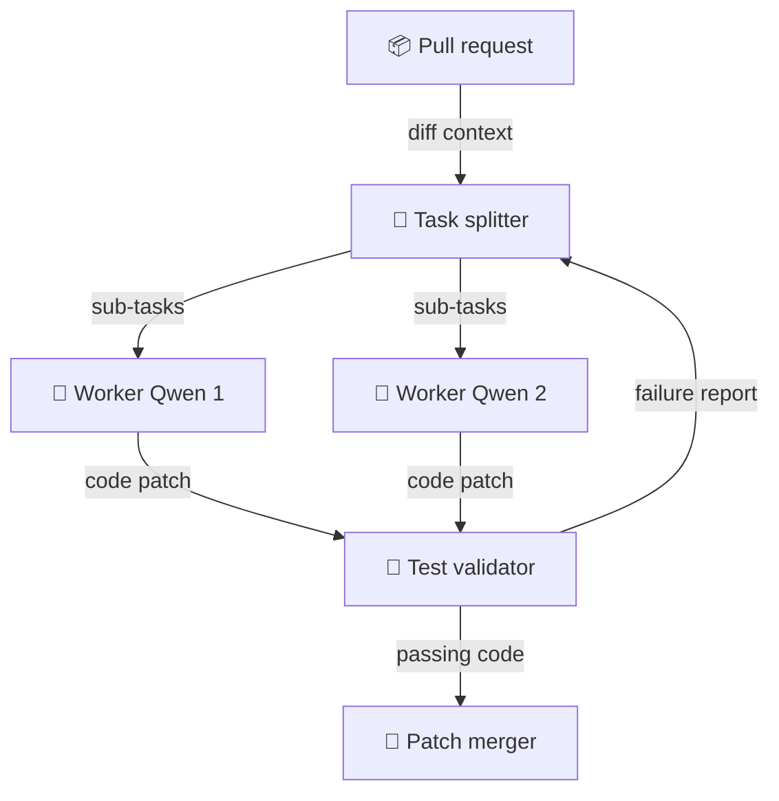

> **TL;DR**
> - Five instances of a 27B model configured in the Memdoor architecture outperform Fable 5 on LiveCodeBench Hard.
> - A 27B model represents roughly 1% of the parameter count of a 2-3T frontier model.
> - Parallel subagent workflows can expand token usage by 15x, leading some evaluation studies to find single models faster and cheaper for equivalent quality.

Using the Memdoor architecture, a team of 5 Qwen3.8-27B models. That benchmark outcome stands out because a 27B model represents only about 1% of the parameter size of a 2-3T frontier model. I think this result shows that architectural coordination can offset raw parameter count.

## The tax of compounding errors

Adding a dedicated reviewer pass to execute tests or inspect outputs catches small errors before they cause a task to fail. I'd always prefer deterministic test feedback over letting a single model guess its way through complex code revisions.

## Token inflation and harness baselines

I'm not convinced that multi-agent routing is universally superior to running larger models. Comparing an orchestrated team against a single unassisted call to a frontier model creates an asymmetric baseline. When wrapped in a full execution harness, a frontier model also runs tests, conducts reviews, and iteratively fixes errors.

Parallel agent architectures can also increase token consumption by 15x, which research on subagents noted made coding tasks a poor fit. Separate benchmark evaluations have found single agents to be faster and cheaper while achieving comparable quality.

> I think relying on structured open-weight ensembles with explicit verification loops is a far better investment than paying cloud API tax on single massive prompts.

My read is that subagent ensembles only earn their keep when paired with automated test execution to prune invalid solutions early.

## Draft design

Assume a background code-refactoring service handling 500 pull request reviews daily, constrained to a single local GPU server with a 3-minute latency window per task.

*Figure: Parallel worker nodes refactor independent sub-tasks before sending combined patches to a local validation step.*

| Option | When it wins | Cost / risk |
| --- | --- | --- |
| Single frontier API call | Strict real-time interactive requirements | High per-token cost; single-pass syntax failures |
| Homogeneous 27B ensemble | Dedicated local GPUs and existing test suites | 15x token consumption penalty; risk of feedback loops |
| Single 27B model with retry | Limited VRAM capacity | Sequential latency stack; limited solution exploration |

### Open questions
- What is the exact token overhead ratio of running five parallel instances versus a sequential retry loop on the same model?
- How much performance improves when models are run with a window?
- At what threshold of prompt complexity does agent coordination overhead overtake the quality gains of simple iterative retry loops?
