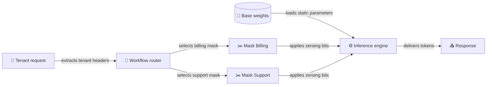

> **TL;DR**
> - Zeroing fewer than 0.05% of weights matches full fine-tuning at scale across reinforcement learning with verifiable rewards, supervised fine-tuning, and on-policy distillation.
> - Under reinforcement learning, Deletion Tuning keeps prior-task accuracy near the base level, while full fine-tuning, LoRA, and random sparse fine-tuning lose up to 5.4 points.
> - Weight-Space Programming lets reasoning agents inspect and modify neural network parameters directly as an alternative to gradient-based model adaptation.

Zeroing fewer than 0.05% of an LLM's weights matches full fine-tuning at scale across supervised fine-tuning, reinforcement learning with verifiable rewards, and on-policy distillation. That finding breaks the reflexive assumption that steering agent behavior requires piling new parameters on top of old ones. For years, post-training has resembled adding extra floors to a shaky skyscraper when all the foundation needed was a single corroded beam pulled out. I think treating adaptation as subtraction rather than addition is the first genuinely fresh direction in agent tuning.

### The gate projection scalpel

The base weights do not shift. Instead, the researchers find that.

Because the process stores only a sparse binary mask over gate projections, the trained mask is hundreds to thousands of times smaller than the corresponding full fine-tuning checkpoint. One commenter envisioned having a 100GB model on disk paired with a 500MB monthly update to upgrade its capabilities. I'd much rather distribute kilobyte-scale bitmasks to edge workers than shuffle multi-gigabyte checkpoints across cluster storage.

### Protecting prior capabilities

The central headache in recurring agent maintenance is catastrophic forgetting. In this context,. Under reinforcement learning, Deletion Tuning's prior-task accuracy stays near the base level, whereas full fine-tuning, LoRA, and random sparse fine-tuning lose up to 5.4 points.

> I think shipping modular, lightweight parameter masks will prove far cleaner for production agents than stacking LoRA adapters that drift away from base capabilities.

To explain why masking matches heavier updates, the researchers analyzed weight changes under reinforcement learning using stable rank, spectrum drift, and principal-weight overlap. Deletion Tuning proved closest to full fine-tuning across all three geometric measures compared to LoRA and random sparse tuning. Zeroing a targeted fraction of a percent appears to emulate the directional outcome of a full gradient update far better than low-rank rank decompositions do.

### Direct weight updates

Separately,. But modifying weights directly brings real friction: cross-task generalization and practical limitations remain insufficiently understood. I'm not convinced that autonomous weight rewriting is safe enough for live production loops without formal verification, but frozen base weights paired with hot-swappable deletion masks offer immediate utility.

## Draft design

Assume a multi-tenant agent platform serving 40,000 requests an hour across distinct corporate workflows, with a strict 120 ms latency ceiling on a shared 70B model.

*Figure: The runtime keeps a single base model immutable in GPU memory, dynamically swapping tiny task-specific gate bitmasks into the forward pass per request.*

| Option | When it wins | Cost / risk |
| :--- | :--- | :--- |
| Deletion Tuning | When prior-task accuracy cannot risk dropping up to 5.4 points | I suspect it needs kernel support for fast binary masking on gate projections |
| LoRA Adapter | When existing serving frameworks already bundle multi-LoRA switching | Under reinforcement learning,. |
| Full Fine-Tuning | When radical structural modifications require changing deep token representations | Checkpoints are hundreds to thousands of times larger than masks |

### Open questions

1. What is the kernel latency overhead of applying bitmask zeroing within fused SwiGLU operations inside vLLM?
2. Can two distinct deletion masks be composed simultaneously via logical OR without causing unintended behavioral regressions?
3. Do learned gate projection masks remain effective when base weights are quantized to 4-bit formats?
