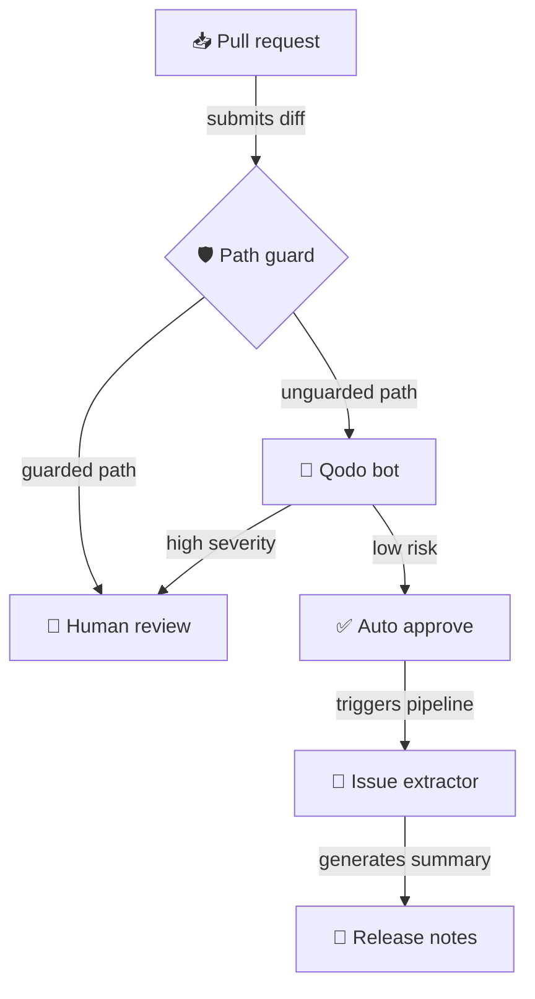

> **TL;DR**
> - Generating a feature with AI might take five minutes, but spending an hour verifying it means it took sixty-five minutes to deliver.
> - Qodo's policy-driven auto-approval validated a typo fix in about a minute, but blocked an authentication TTL change under `src/auth/**` despite a clean code review.
> - Feeding raw git diffs to an LLM caused an emergency memory leak fix to be hallucinated as a JSON serialization optimization in release notes.

When an LLM built a native iOS habit tracker, DeepSeek 4.1 Flash marked a daily coffee limit as met after a user logged their first cup at 9 AM. The generated code could pass every unit test while executing flawed business logic. Generating code is fast becoming cheap, but verifying system intent remains the primary bottleneck in engineering.

## Architecture as a Verification Boundary

DeepSeek split its project into App, Data, Design, Domain, Features, Resources, and Services, whereas GPT-6.2 SOL combined persistence, migrations, business rules, and notification scheduling inside `HabitStore.swift`. I think separating concerns is even more vital when relying on AI generators. Isolating logic in `HabitEngine` away from `TendRepository` allows an engineer to test evaluation rules without executing database transactions or triggering notifications.

## Policy-Driven Guardrails for the Autonomous Queue

I'd expect that automated pull request queues can become less efficient when routine fixes still require human eyes. In a trial of Qodo's policy-driven auto-approval, a one-line typo fix in `format.js` was reviewed and auto-approved in roughly a minute. Conversely, when a PR modified session duration from 30 to 60 minutes in `src/auth/session.js`, an approval guard on `src/auth/**` held the change for human review despite a clean automated report.

> I think automated PR approval is only as reliable as its guardrails, and no bot should ever merge code without explicit human policy governing critical paths.

I'd avoid treating automated approval as a static seal. When a subsequent commit altered `amountInCents / 100` to `amountInCents / 10`, Qodo identified a high-severity flaw and revoked its previous approval. For multi-PR agent sessions, Qodo's Agent Session Review consolidates every PR into a single local review session before anything reaches production.

## Extracting Context Beyond Syntactic Diffs

Syntactic changes fail to explain underlying intent. Feeding raw `git diff` output to an LLM led to a patch for a production memory leak being described as a JSON serialization speedup in release notes. Diffs show that `timeoutMs` changed from 5000 to 15000, but obscure socket drops during infrastructure shifts.

Agent PR descriptions frequently fall into an unsupported-plausible archetype by creating believable but unbacked explanations. The `@necoz-oss/changelog-bot` extractor parses closing keywords to link PRs back to GitHub issues for context. To validate extraction reliability, pipelines must test models against counterfactual decoy sets to calculate False Positive Rates.

## Draft design

Assume an engineering team managing 50 agent-authored pull requests per day, requiring under 5 minutes latency for low-risk changes while enforcing human approvals on authentication modules.

*Figure: An automated verification workflow routing routine changes to policy auto-approval while trapping guarded paths for human inspection.*

| Option | When it wins | Cost / risk |
| :--- | :--- | :--- |
| Direct Diff Summarization | Quick internal scripting | High risk of hallucinated user rationales |
| Policy-Driven Approval Workflows | High volume of routine typo fixes and dependency updates | Unhandled risk if policies are misconfigured |
| Issue-Linked Context Extraction | Production releases requiring audited user intent | Overhead from API limits and issue parsing |

### Open questions
- How should we calibrate the target False Positive Rate on our counterfactual decoy benchmark prior to turning on auto-approval?
- Which file paths besides `src/auth/**` require permanent guardrails against automated approval?
- How will the pipeline handle issue context extraction if GitHub API rate limits are exceeded during deployment spikes?

Before enabling policy-driven auto-approval across your repositories, run your historical PR diffs through a counterfactual decoy test to measure how accurately your setup rejects unsupported explanations.
